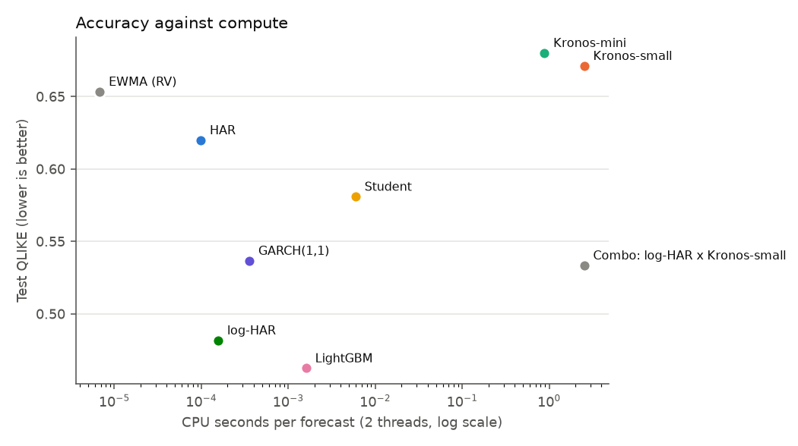
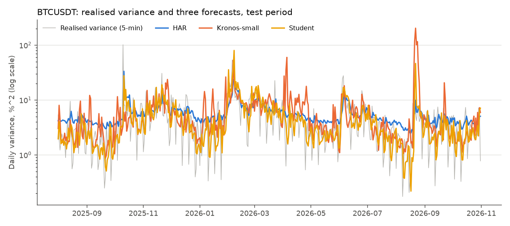

# Kronos vs HAR-RV: next-day crypto volatility after the foundation model's data cutoff

Every number below is read from `results/` by `python -m kvh.cli report`; nothing in the tables was typed by
hand.

## Headline

**A 2,369-parameter student beats the 28.7M-parameter Kronos model it was trained to copy, and neither beats
the classical volatility models.** The test covers 15 months of Binance data published after the Kronos
weights: Aug 2025 to Oct 2026, 10 USDT pairs, 4,570 asset-days per model.



* **The student beats its teacher.** The MLP was trained only to imitate pre-test Kronos-small forecasts. On
  test it scores QLIKE 0.581 against the teacher's 0.671 (DM -4.08,
  p < 0.001).
  * Its forward pass takes 31 microseconds, against 2.5 CPU-seconds per teacher
    forecast.
  * It does not significantly beat HAR (DM -0.55, p = 0.584), and it stays behind log-HAR.
* **Kronos does not beat HAR-RV.** Zero-shot Kronos variance forecasts, even with a scale fitted on
  validation, score pooled QLIKE 0.680 (mini) and 0.671 (small), against
  0.620 for HAR. The DM statistics are 0.56 and 0.61 (p = 0.579 and
  0.541), so the difference is not significant.
* **It is significantly worse than the stronger classical models.** Those are log-HAR (0.482) and
  LightGBM on HAR features (0.463, the best model). Kronos-base, on a BTC/ETH subset, is worse
  still.
* **Kronos adds nothing to log-HAR.** Averaging log-HAR with Kronos-small gives 0.533,
  worse than log-HAR alone.
* **Turbulent days decide the comparison with HAR.**
  * On the calmer 80% of days, Kronos beats level-HAR. On the top RV quintile it loses heavily.
  * One day dominates: the 2025-10-10 crash. Its cross-asset mean RV was about 220 times the median day's,
    and 22 times the next-worst day's. It adds 0.26 to 0.36 to every model's mean QLIKE.
  * Dropping that day is a post-hoc reading, not the test. Without it, Kronos edges ahead of HAR, but still
    not significantly (DM -0.87 and -0.75). It stays significantly worse than log-HAR. The
    student then beats HAR significantly (DM -2.82).
* **Answer to the question.** Does Kronos beat HAR-RV after its data cutoff? No. The student keeps, and
  improves on, whatever Kronos knows about tomorrow's variance, but what Kronos knows is not an edge over the
  2009 benchmark.

## Question

Kronos (Shi et al., "Kronos: A Foundation Model for the Language of Financial Markets", arXiv 2508.02739,
AAAI 2026) is a decoder-only transformer pretrained on 12 billion candlesticks from 45 exchanges, Binance spot
crypto included. The paper reports a 9% lower MAE than the best baseline for volatility forecasting. Here we ask
two questions on data Kronos could not have seen:

1. Does a Kronos variance forecast beat the HAR-RV model of Corsi (2009) at next-day realised variance?
2. Can a student network under 100k parameters, distilled from Kronos-small on pre-test data only, keep
   Kronos's edge at a fraction of the cost?

## Design in one screen

* **Data.** Binance spot, 10 USDT pairs: BTC, ETH, SOL, BNB, XRP, DOGE, ADA, LTC, LINK and TRX. Monthly
  1h and 5m klines from data.binance.vision, 2020-01 to 2026-10, each SHA-256 `.CHECKSUM` verified.
* **Target.** RV of UTC day d = the sum of its 288 squared 5-minute log returns.
* **Forecast time.** 00:00 UTC of day d. Every model sees only candles closed by then.
* **Kronos data end.**
  * The paper says "the pre-training data for Kronos extends up to June 2024".
  * Kronos-mini is not in the paper. So the cutoff we use is the HuggingFace weights upload, 2025-06-30 for
    small and base and 2025-07-01 for mini and its tokenizer. Every later commit only edits the README.
  * **Test: 2025-08-01 to 2026-10-31**, after a one-month embargo. That is 457 days and 4,570
    asset-days scored by every model.
  * Validation: 2024-07-01 to 2025-06-30.
* **Kronos forecast.**
  * Input: the last 488 hourly candles (OHLCV and quote volume).
  * Output: N sampled 24-hour candle paths. The variance forecast is the mean over paths of the per-path
    variance: either the sum of squared hourly close-to-close log returns, or Parkinson on the predicted
    high/low.
  * Raw paths underestimate 5-minute RV, so the headline Kronos rows multiply by a single scale c per model.
    c is fitted on validation and frozen; it is the QLIKE-optimal constant, mean(RV / raw). Raw rows are
    also shown.
* **Chosen on validation only:** sampling temperature and top-p, the variance variant, N, c, the HAR
  windows and the student hyper-parameters. The frozen config's hash is
  `aba34451afb79a02c00eb30666af95523f4e942fea61ff9cf232962c0b8c608b`.
* **Baselines.**
  * HAR-RV (Corsi 2009; lags 1, 7 and 30 days because crypto trades 24/7) and log-HAR, both OLS refitted
    every day.
  * EWMA with RiskMetrics lambda = 0.94, on squared returns and on RV.
  * GARCH(1,1), refitted monthly on 1,000 days.
  * LightGBM on HAR features, pooled across assets and refitted monthly.
* **Student.**
  * Model: an MLP on 39 features. They are HAR-style daily log-RV lags plus the last 24 hourly log
    squared ranges.
  * Training: on Kronos-small forecasts from 2022-01 to 2025-06 only (teacher on every 6th day), then
    scored on the test period like every other model.
* **Kronos inference on 2 CPU threads.**
  * The vendored model is re-run with a key/value cache: encode and prefill once, then copy to N paths.
  * A pytest checks it against the original code under greedy decoding.
  * Speed: about 0.3 s of wall time per 16-path forecast for mini, 1.2 s for small and 3.2 s for base
    (throughput test). A full-window
    pass per step and per sample would cost roughly 200 times more.

## Main result (test period, pooled over 10 assets)

Read the table as follows:

* QLIKE (primary) = RV/F - log(RV/F) - 1. MSE is in (%^2)^2.
* MZ R^2 regresses log RV on log F.
* DM is the Diebold-Mariano statistic against HAR. It is computed on the daily cross-sectional mean of the
  loss differential, with Newey-West lag 7. Negative means better than HAR.
* CPU cost is process time per forecast on 2 threads; Kronos counts as 2 CPU-seconds per wall second. Every
  Kronos run sampled 16 paths. Kronos-small and -base use the first 8 (the validation choice), so at N = 8
  their cost would be roughly halved.
* "(raw)" means the Kronos forecast without the validation scale.

| Model | QLIKE | QLIKE / HAR | MSE ((%^2)^2) | MZ R^2 (log) | DM vs HAR (QLIKE) | p | DM vs HAR (MSE) | p (MSE) | CPU s / forecast | Parameters |
|---|---|---|---|---|---|---|---|---|---|---|
| HAR | 0.6199 | 1.000 | 17360.6 | 0.507 |  |  |  |  | 9.92e-05 | 4 |
| log-HAR | 0.4818 | 0.777 | 15865.0 | 0.656 | -4.98 | <0.001 | -1.07 | 0.283 | 0.000157 | 5 |
| EWMA (RV) | 0.6534 | 1.054 | 15447.3 | 0.524 | 0.38 | 0.706 | -0.91 | 0.363 | 6.84e-06 | 0 (lambda fixed) |
| EWMA (r2) | 0.6241 | 1.007 | 15030.5 | 0.563 | 0.05 | 0.960 | -1.04 | 0.297 | <4e-06 (timer floor) | 0 (lambda fixed) |
| GARCH(1,1) | 0.5367 | 0.866 | 15001.1 | 0.559 | -5.10 | <0.001 | -1.05 | 0.295 | 0.000359 | 4 |
| LightGBM | 0.4625 | 0.746 | 15312.9 | 0.666 | -7.36 | <0.001 | -1.05 | 0.292 | 0.00161 | 300 trees x 15 leaves |
| Kronos-mini | 0.6801 | 1.097 | 15132.4 | 0.538 | 0.56 | 0.579 | -0.99 | 0.322 | 0.884 | 4.1M + 4.0M tok. |
| Kronos-mini (raw) | 1.6343 | 2.636 | 15096.3 | 0.538 | 1.71 | 0.087 | -1.03 | 0.301 | 0.884 | 4.1M + 4.0M tok. |
| Kronos-small | 0.6712 | 1.083 | 15793.7 | 0.508 | 0.61 | 0.541 | -0.79 | 0.432 | 2.54 | 24.7M + 4.0M tok. |
| Kronos-small (raw) | 1.2584 | 2.030 | 15229.5 | 0.508 | 1.69 | 0.091 | -1.00 | 0.320 | 2.54 | 24.7M + 4.0M tok. |
| Student | 0.5809 | 0.937 | 15069.6 | 0.642 | -0.55 | 0.584 | -1.03 | 0.301 | 0.00597 | 2,369 |
| Combo: log-HAR x Kronos-small | 0.5335 | 0.861 | 15368.7 | 0.626 | -1.75 | 0.080 | -1.05 | 0.296 | 2.54 | log-HAR + Kronos-small |


**Model confidence set** (Hansen, Lunde & Nason 2011). It uses the T_max statistic on daily pooled QLIKE,
a 7-day block bootstrap with 2,000 draws, and alpha = 10%.

| Model | MCS p-value | In 90% MCS |
|---|---|---|
| Kronos-small | 0.052 | False |
| EWMA (RV) | 0.151 | True |
| Kronos-mini | 0.151 | True |
| HAR | 0.151 | True |
| EWMA (r2) | 0.151 | True |
| Student | 0.190 | True |
| GARCH(1,1) | 0.190 | True |
| Combo: log-HAR x Kronos-small | 0.190 | True |
| log-HAR | 0.288 | True |
| LightGBM | 1.000 | True |

At 10% the MCS removes only Kronos-small. Daily pooled QLIKE is dominated by a few crash days, so the set is
wide: even level-HAR stays in it.

**Pairwise DM tests other than "vs HAR".** These are a post-hoc reading of the same frozen test forecasts
(`scripts/extra_dm.py` -> `results/dm_extra.csv`): no refit and no new forecast. Each test uses the same
pooled statistic as the main table, and a positive value means the first model is worse.

| Model | versus | n | Mean QLIKE difference | DM | p |
|---|---|---|---|---|---|
| Kronos-small | log-HAR | 4570 | +0.1894 | +2.88 | 0.004 |
| Kronos-mini | log-HAR | 4570 | +0.1984 | +2.22 | 0.027 |
| Combo: log-HAR x Kronos-small | log-HAR | 4570 | +0.0517 | +1.79 | 0.073 |
| Student | Kronos-small | 4570 | -0.0902 | -4.08 | <0.001 |
| Student | log-HAR | 4570 | +0.0992 | +1.93 | 0.053 |
| Kronos-mini | Kronos-small | 4570 | +0.0089 | +0.28 | 0.779 |
| LightGBM | log-HAR | 4570 | -0.0193 | -1.07 | 0.284 |

**Without the 2025-10-10 crash day.** This is a post-hoc reading of the same frozen forecasts
(`results/robustness_excl_crash.csv`), not the pre-registered test.

| Model | QLIKE, all 457 days | QLIKE, without 2025-10-10 | DM vs HAR | p vs HAR | DM vs log-HAR | p vs log-HAR |
|---|---|---|---|---|---|---|
| HAR | 0.6199 | 0.3612 |  |  | +6.11 | <0.001 |
| log-HAR | 0.4818 | 0.2110 | -6.11 | <0.001 |  |  |
| GARCH(1,1) | 0.5367 | 0.2796 | -5.09 | <0.001 | +3.75 | <0.001 |
| LightGBM | 0.4625 | 0.2078 | -7.28 | <0.001 | -0.47 | 0.636 |
| Kronos-mini | 0.6801 | 0.3203 | -0.87 | 0.385 | +3.84 | <0.001 |
| Kronos-small | 0.6712 | 0.3351 | -0.75 | 0.451 | +7.31 | <0.001 |
| Student | 0.5809 | 0.2589 | -2.82 | 0.005 | +2.71 | 0.007 |
| Combo: log-HAR x Kronos-small | 0.5335 | 0.2334 | -4.66 | <0.001 | +3.55 | <0.001 |

## Per asset (QLIKE; DM and p for Kronos-small against HAR)

| Asset | HAR | log-HAR | GARCH(1,1) | LightGBM | Kronos-mini | Kronos-small | Student | DM Kronos-small vs HAR | p | best |
|---|---|---|---|---|---|---|---|---|---|---|
| BTC | 0.302 | 0.275 | 0.321 | 0.272 | 0.353 | 0.402 | 0.403 | 3.46 | <0.001 | LightGBM |
| ETH | 0.275 | 0.250 | 0.344 | 0.255 | 0.398 | 0.374 | 0.371 | 1.88 | 0.059 | log-HAR |
| SOL | 0.261 | 0.215 | 0.280 | 0.211 | 0.298 | 0.323 | 0.259 | 2.70 | 0.007 | LightGBM |
| BNB | 0.566 | 0.327 | 0.437 | 0.318 | 0.411 | 0.413 | 0.456 | -2.88 | 0.004 | LightGBM |
| XRP | 0.558 | 0.500 | 0.411 | 0.480 | 0.587 | 0.585 | 0.557 | 0.58 | 0.564 | GARCH(1,1) |
| DOGE | 1.024 | 0.730 | 0.723 | 0.729 | 0.744 | 0.987 | 0.952 | -0.22 | 0.830 | GARCH(1,1) |
| ADA | 1.207 | 1.093 | 0.995 | 1.000 | 1.900 | 1.500 | 1.236 | 0.74 | 0.462 | GARCH(1,1) |
| LTC | 0.809 | 0.477 | 0.739 | 0.442 | 0.384 | 0.486 | 0.403 | -2.17 | 0.030 | Kronos-mini |
| LINK | 0.746 | 0.588 | 0.571 | 0.566 | 0.915 | 0.928 | 0.669 | 0.61 | 0.544 | LightGBM |
| TRX | 0.451 | 0.363 | 0.546 | 0.352 | 0.812 | 0.715 | 0.504 | 1.12 | 0.263 | LightGBM |

## Splits (QLIKE; DM statistic against HAR in brackets)

* Turbulent days are the top RV quintile per asset over the test period, defined on the realised target.
  Calm days are the rest.
* BTC/ETH are compared with the eight alts.

| Split | n | HAR | log-HAR | GARCH(1,1) | LightGBM | Kronos-mini | Kronos-small | Student |
|---|---|---|---|---|---|---|---|---|
| calm | 3650 | 0.391 | 0.174 (-9.5) | 0.268 (-6.6) | 0.188 (-8.6) | 0.245 (-4.1) | 0.270 (-2.6) | 0.192 (-5.9) |
| turbulent | 920 | 1.530 | 1.703 (+2.9) | 1.603 (+2.8) | 1.552 (+1.7) | 2.407 (+2.5) | 2.264 (+3.2) | 2.124 (+2.9) |
| BTC/ETH | 914 | 0.288 | 0.262 (-2.0) | 0.332 (+3.6) | 0.263 (-1.8) | 0.375 (+1.8) | 0.388 (+2.7) | 0.387 (+2.2) |
| alts | 3656 | 0.703 | 0.537 (-5.0) | 0.588 (-6.0) | 0.512 (-7.4) | 0.756 (+0.4) | 0.742 (+0.4) | 0.630 (-0.9) |




## Kronos-base (subset)

Kronos-base was run only on BTC and ETH, every 4th test day, to fit the compute budget. Every model is
scored on those same asset-days.

| Model | n | QLIKE | MSE | MZ R^2 | DM vs HAR | p |
|---|---|---|---|---|---|---|
| HAR | 230 | 0.2827 | 55.5 | 0.448 |  |  |
| log-HAR | 230 | 0.2377 | 45.2 | 0.475 | -2.73 | 0.006 |
| LightGBM | 230 | 0.2268 | 46.2 | 0.519 | -3.11 | 0.002 |
| Kronos-mini | 230 | 0.3116 | 149.6 | 0.386 | 0.94 | 0.346 |
| Kronos-small | 230 | 0.3578 | 333.0 | 0.322 | 2.67 | 0.008 |
| Kronos-base | 230 | 0.4960 | 718.9 | 0.306 | 4.77 | <0.001 |
| Kronos-base (raw) | 230 | 0.5011 | 409.7 | 0.306 | 4.06 | <0.001 |
| Student | 230 | 0.3449 | 39.2 | 0.444 | 1.45 | 0.147 |

## Distillation

|  | Student (MLP) | Teacher (Kronos-small) | HAR |
|---|---|---|---|
| Parameters | 2,369 | 28,699,418 (incl. tokenizer) | 4 (OLS) |
| CPU time per forecast | 31 us forward + 5938 us features | 2.54 s (16 paths sampled, first 8 used) | 99 us (refit daily) |
| Speed-up vs teacher | 425x | 1x |  |
| Test QLIKE | 0.5809 | 0.6712 | 0.6199 |
| Test MZ R^2 (log) | 0.642 | 0.508 | 0.507 |
| DM vs HAR (QLIKE), p | -0.55, 0.584 | 0.61, 0.541 |  |
| Fidelity to teacher on test: R^2 of log forecast | 0.670 | 1 |  |
| Fidelity: correlation of log forecasts | 0.843 | 1 |  |
| Fidelity: QLIKE(teacher, student) | 0.3433 | 0 |  |

The cost-against-accuracy figure is under the headline.

## Compute

Kronos on the test period, measured during the run:

| Model | Forecasts | CPU s / forecast | Wall s / forecast | Total CPU h (test) |
|---|---|---|---|---|
| Kronos-mini | 4570 | 0.88 | 0.45 | 1.12 |
| Kronos-small | 4570 | 2.54 | 1.28 | 3.22 |
| Kronos-base | 230 | 5.17 | 2.62 | 0.33 |

Total Kronos CPU time on the test period: 4.7 CPU-hours, all on 2 threads.

Throughput measured before sizing the run:

| Model | N | days per batch | wall s | CPU s |
|---|---|---|---|---|
| mini | 16 | 8 | 0.30 | 0.60 |
| mini | 32 | 4 | 0.60 | 1.16 |
| small | 16 | 4 | 1.15 | 2.24 |
| small | 32 | 2 | 2.06 | 4.01 |
| base | 16 | 1 | 3.23 | 6.29 |
| base | 32 | 1 | 5.32 | 10.29 |

## Validation (all choices made here)

Kronos sampling settings. For each model and setting, the row shows the best variant and N. Settings are
compared on the same asset-days; the QLIKE is after the scale c.

* T06 means T = 0.6, top-p 0.9 (the paper's forecasting setting).
* T09 means T = 0.9, top-p 0.9 (the paper's volatility setting).
* T10 means T = 1.0, top-p 1.0 (pure sampling).

| Model | Setting | Best variant | N | Forecasts | Scale c | QLIKE raw | QLIKE calibrated | HAR, same days |
|---|---|---|---|---|---|---|---|---|
| base | T06 | park | 8 | 122 | 1.25 | 0.4343 | 0.4080 | 0.2349 |
| mini | T09 | cc_rec | 16 | 610 | 2.31 | 0.6889 | 0.2169 | 0.2431 |
| mini | T10 | cc_rec | 16 | 610 | 0.84 | 0.2697 | 0.2549 | 0.2431 |
| mini | T06 | park | 16 | 610 | 2.27 | 0.7331 | 0.2815 | 0.2431 |
| small | T06 | park | 8 | 410 | 1.86 | 0.4917 | 0.2519 | 0.2284 |
| small | T09 | park | 16 | 410 | 1.13 | 0.2852 | 0.2778 | 0.2284 |
| small | T10 | park | 16 | 410 | 0.51 | 0.4724 | 0.2896 | 0.2284 |

Variance extraction x number of paths (calibrated QLIKE, best setting):

| model | variant | N=4 | N=8 | N=16 |
|---|---|---|---|---|
| mini | cc_act | 0.2581 | 0.2266 | 0.2177 |
| mini | cc_rec | 0.2556 | 0.2252 | 0.2169 |
| mini | park | 0.2833 | 0.2621 | 0.2582 |
| small | cc_act | 0.3753 | 0.3657 | 0.3420 |
| small | cc_rec | 0.3774 | 0.3658 | 0.3414 |
| small | park | 0.2582 | 0.2519 | 0.2531 |

HAR windows:

| model | window | val_qlike | n |
|---|---|---|---|
| HAR | 365 days | 0.3206 | 3650 |
| HAR | 730 days | 0.3059 | 3650 |
| HAR | expanding | 0.3413 | 3650 |
| log-HAR | 365 days | 0.2701 | 3650 |
| log-HAR | 730 days | 0.2696 | 3650 |
| log-HAR | expanding | 0.2603 | 3650 |

Student hyper-parameters (selected by QLIKE against realised RV on validation):

| width | wd | epochs | params | val_qlike_rv | val_qlike_vs_teacher | val_r2_log_teacher |
|---|---|---|---|---|---|---|
| 32 | 0.0001 | 100 | 2369 | 0.2888 | 0.2101 | 0.7382 |
| 32 | 0.0001 | 300 | 2369 | 0.3185 | 0.2484 | 0.7097 |
| 32 | 0.01 | 100 | 2369 | 0.2879 | 0.2095 | 0.7385 |
| 32 | 0.01 | 300 | 2369 | 0.3154 | 0.2527 | 0.7073 |
| 64 | 0.0001 | 100 | 6785 | 0.2990 | 0.2256 | 0.7226 |
| 64 | 0.0001 | 300 | 6785 | 0.4621 | 0.3536 | 0.5988 |
| 64 | 0.01 | 100 | 6785 | 0.2991 | 0.2245 | 0.7236 |
| 64 | 0.01 | 300 | 6785 | 0.4486 | 0.3364 | 0.6023 |

Frozen choices:

```json
{
 "har_windows": {
  "HAR": 730,
  "log-HAR": 0
 },
 "kronos": {
  "base": {
   "n": 8,
   "scale": 1.2476787236211297,
   "tag": "T06",
   "val_forecasts": 122,
   "val_qlike_cal": 0.40795499880781155,
   "variant": "park"
  },
  "mini": {
   "n": 16,
   "scale": 2.308707934616415,
   "tag": "T09",
   "val_forecasts": 610,
   "val_qlike_cal": 0.21690031013338257,
   "variant": "cc_rec"
  },
  "small": {
   "n": 8,
   "scale": 1.8606867928848636,
   "tag": "T06",
   "val_forecasts": 410,
   "val_qlike_cal": 0.2519385627789468,
   "variant": "park"
  }
 },
 "student": {
  "hp": {
   "epochs": 100,
   "wd": 0.01,
   "width": 32
  },
  "n_train": 1930,
  "params": 2369,
  "scale": 1.8606867928848636
 }
}
```

Test log (`results/test_log.jsonl`):

- run 1: 2026-11-22T09:41:33+00:00, config aba34451afb7, code a0cc4e422d02, forced=False

## What is new here

* **A test Kronos could not have seen, with the cutoff documented.**
  * Cutoff evidence: the paper's stated data end (June 2024), plus HuggingFace commit dates showing the
    weights unchanged since 2025-06-30 / 07-01.
  * The test starts after a one-month embargo and runs 15 months.
  * A pytest asserts the ordering.
* **Volatility-forecasting evaluation of a financial foundation model.** The paper reports MAE and R^2
  against ARCH/GARCH only. Here it is scored against the HAR family with QLIKE, DM with HAC errors and a
  model confidence set.
* **Variance read from sampled candle paths, not from an averaged path.**
  * The released predictor averages its sample paths before returning them, which shrinks the variance. We
    keep every path.
  * Validation shows that the sampling temperature, not the model, sets the variance level of the paths: the
    close-to-close scale c goes from 8.5 at T = 0.6 to 0.8 at T = 1.0.
  * So a zero-shot Kronos variance needs a calibration step before it is comparable with HAR.
* **Exact, cached CPU inference.** A key/value-cache re-implementation of Kronos sampling, checked against
  the original, makes 16-path, 24-step forecasts cost about a second on 2 threads.
* **A distilled student of a few thousand parameters.** It is trained only on pre-test teacher outputs and
  scored like every other model.

## Limits

* **One asset class, one venue.** 10 Binance USDT pairs over 15 months. The assets are highly correlated, so
  the effective sample is far smaller than 4,570 asset-days. The pooled DM test averages across assets
  each day for that reason.
* **Zero-shot only.** Kronos was not fine-tuned. The repo ships fine-tuning scripts, and a fine-tuned Kronos
  could do better.
* **Small settings search.**
  * Context is fixed at 488 hours.
  * N is at most 16 paths, and mini's validation QLIKE was still falling from N = 8 to 16.
  * The sampling grid has 3 points, searched on a validation subsample (410-610 asset-days per model).
* **The validation year may be inside Kronos-mini's training data.** Mini is not in the paper. This can only
  make mini's validation look better; the test is clean.
* **The calibration scale c is one constant per model, fitted on one year.** If the level bias of the paths
  drifts, c is stale. The raw rows show the uncalibrated forecast.
* **Kronos-base was run only on a small subset**, so its row has wide confidence bands.
* **The student's feature extraction is pandas-bound** (milliseconds). Its network forward pass is tens of
  microseconds.

## Simplifications and deviations

**Scope**
* **Crypto only.** There are no equity ETFs, which the brief made optional.
* **Kronos-base on a subset only.** It ran on BTC and ETH, every 4th test day. Its validation used every 6th
  validation day and reused Kronos-small's sampling setting, since both share a tokenizer. Variant, N and
  scale were fitted on base's own validation subset.

**Kronos validation and training data**
* **Validation on a day subsample, to fit about 3 hours of Kronos compute on 2 threads.** Every 6th
  validation day for mini (610 forecasts per setting) and every 9th for small (410). The settings grid is
  small: T/top-p in {0.6/0.9, 0.9/0.9, 1.0/1.0}. The context length is fixed at 488 hours for every size;
  Kronos-mini could take 2,048, but that was not tried.
* **Teacher on a subsample.** The distillation teacher ran on every 6th day from 2022-01 to 2024-06, plus the
  validation subsample. Those inputs predate the paper's June 2024 data end, so the teacher may be partly
  in-sample there. That is harmless for distillation: the student copies the teacher's function. The student
  is still scored only on the test period.

**Calibration and the target**
* **One pooled scale c per Kronos model**, not one per asset. c is fitted on validation as the
  QLIKE-optimal constant. Raw Kronos rows are reported too.
* **HAR lags are 1, 7 and 30 calendar days**, not Corsi's 1, 5 and 22 trading days, because crypto trades
  every day.
* **Insanity filter on HAR.** A level-HAR forecast outside the range of its own fitting window is replaced
  by that window's mean (Bollerslev, Patton & Quaedvlieg 2016). Without it, one TRX day had QLIKE above 500
  on validation.
* **GARCH(1,1)** uses a normal QMLE with a constant mean, on close-to-close daily returns at 00:00 UTC. It is
  refitted monthly and filtered daily in between.
* **The target is the 5-minute RV**, a noisy proxy of the latent variance. QLIKE and MSE still rank forecasts
  consistently under such a proxy (Patton 2011).

**Statistics and cost accounting**
* **Turbulent days are defined ex post**, as the top RV quintile per asset over the test period. This is a
  conditional evaluation, not a tradeable regime signal.
* **DM tests** use Newey-West lag 7 without the Harvey-Leybourne-Newbold small-sample correction (n = 457
  days). The pooled test averages the loss differential across assets each day. DM p-values are not adjusted
  for multiple comparisons; the MCS covers that.
* **CPU cost.** For Kronos it is the process time of the sampling call, excluding data loading. For baselines
  it is total fitting and forecasting time divided by the number of forecasts. The student is timed at batch
  size 1, forward pass and feature extraction reported separately.
* **Data repairs.** Hourly gaps (31 hours in 6.8 years) are filled flat at the last close with zero volume.
  The 7 days with fewer than 260 of 288 five-minute bars are kept and flagged.

**Order of runs.** The Kronos test-period forecasts were generated (with the frozen Kronos settings) before
the student was fitted and the full config frozen. The student reads no test-period file, and all scoring
happened once, after `freeze`. See PLAN.md, "Changes during the build".

## How to run

```bash
git clone https://github.com/mohymabrouk/kronos-vs-har-after-cutoff.git
cd kronos-vs-har-after-cutoff
export PYTHONIOENCODING=utf-8 OMP_NUM_THREADS=2 MKL_NUM_THREADS=2 OPENBLAS_NUM_THREADS=2
uv sync
uv run python -m kvh.cli download          # Binance 1h + 5m monthly klines, checksums verified (~8 min)
uv run python -m kvh.cli build             # parquet: hourly candles, daily 5-minute RV
uv run python -m kvh.cli throughput        # seconds per forecast per Kronos size on 2 threads
uv run python -m kvh.cli kronos --period val --models mini --tag T06,T09,T10 --stride 6
uv run python -m kvh.cli kronos --period val --models small --tag T06,T09,T10 --stride 9
uv run python -m kvh.cli validate          # choose Kronos setting/variant/N/scale and HAR windows
uv run python -m kvh.cli kronos --period distill --models small --stride 6     # teacher, pre-validation
uv run python -m kvh.cli kronos --period val --models base --symbols BTCUSDT,ETHUSDT --tag <small tag> --stride 6
uv run python -m kvh.cli validate          # adds Kronos-base (mini/small choices unchanged)
uv run python -m kvh.cli distill           # student: choose hyper-parameters on validation, refit pre-test
uv run python -m kvh.cli freeze            # results/frozen_config.json + sha256
uv run python -m kvh.cli kronos --period test --models mini      # frozen settings only (no --tag allowed)
uv run python -m kvh.cli kronos --period test --models small
uv run python -m kvh.cli kronos --period test --models base --symbols BTCUSDT,ETHUSDT --stride 4
uv run python -m kvh.cli test              # scores once; a rerun needs --force and is logged
uv run python -m kvh.cli report            # tables.md, figures, this README
uv run pytest                              # 6 groups of tests
```

The Kronos jobs write one parquet file per (model, setting, asset, month) under
`~/.cache/quant-research/p3/kronos/`, so an interrupted run resumes where it stopped. The model code
is vendored in `third_party/kronos/` (MIT licence, commit 67b630e). The weights are pinned to their
HuggingFace revisions in `src/kvh/config.py`.
