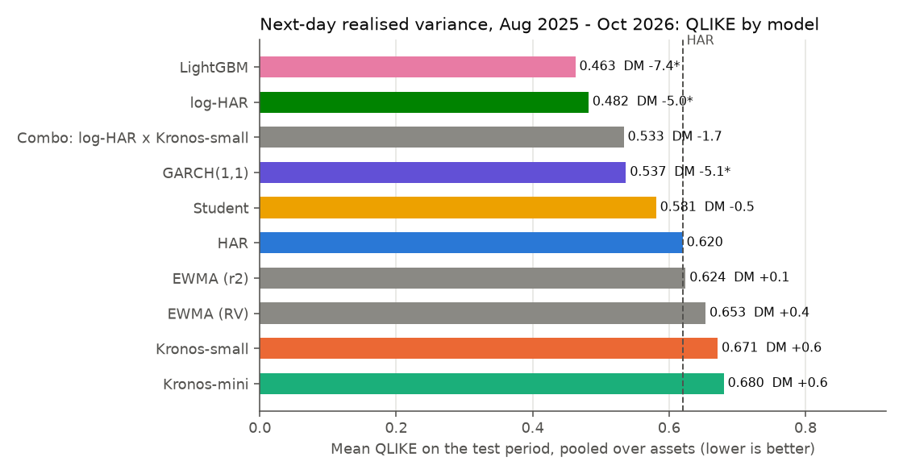
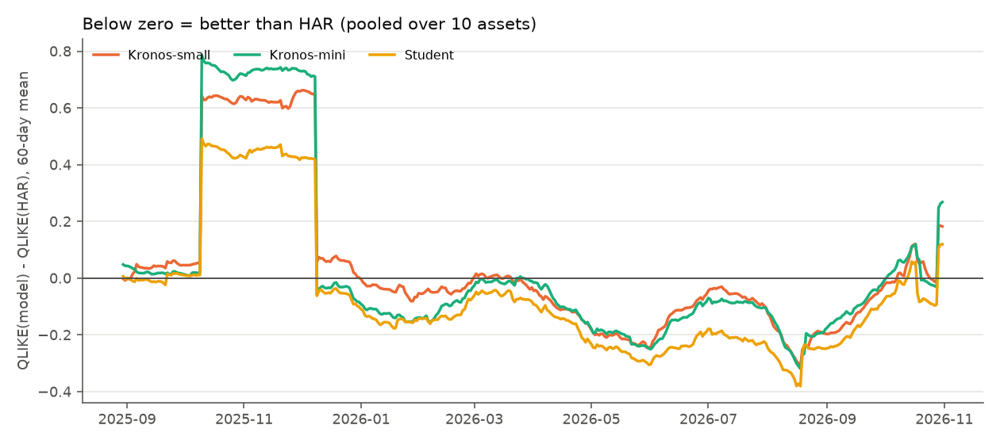

# Kronos vs HAR-RV: next-day crypto volatility after the foundation model's data cutoff

[](https://github.com/mohymabrouk/kronos-vs-har-after-cutoff/actions/workflows/tests.yml)

Every number below is read from `results/` by `python -m kvh.cli report`; nothing in the tables was typed by
hand.

## Headline

**A 2,369-parameter student beats the 28.7M-parameter Kronos model it was trained to copy, and neither beats
the classical volatility models.** The test covers 15 months of Binance data published after the Kronos
weights: Aug 2025 to Oct 2026, 10 USDT pairs, 4,570 asset-days per model.


* **The student beats its teacher.** The MLP was trained only to imitate pre-test Kronos-small forecasts. On
  test it scores QLIKE 0.581 against the teacher's 0.671 (DM -4.08,
  p < 0.001).
  * Its forward pass takes 31 microseconds, against 2.5 CPU-seconds per teacher
    forecast.
  * It does not significantly beat HAR (DM -0.55, p = 0.584), and it stays behind log-HAR.
* **Kronos does not beat HAR-RV.** Zero-shot Kronos variance forecasts, even with a scale fitted on
  validation, score pooled QLIKE 0.680 (mini) and 0.671 (small), against
  0.620 for HAR. The DM statistics are 0.56 and 0.61 (p = 0.579 and
  0.541), so the difference is not significant.
* **It is significantly worse than the stronger classical models.** Those are log-HAR (0.482) and
  LightGBM on HAR features (0.463, the best model). Kronos-base, on a BTC/ETH subset, is worse
  still.
* **Kronos adds nothing to log-HAR.** Averaging log-HAR with Kronos-small gives 0.533,
  worse than log-HAR alone.
* **Turbulent days decide the comparison with HAR.**
  * On the calmer 80% of days, Kronos beats level-HAR. On the top RV quintile it loses heavily.
  * One day dominates: the 2025-10-10 crash. Its cross-asset mean RV was about 220 times the median day's,
    and 22 times the next-worst day's. It adds 0.26 to 0.36 to every model's mean QLIKE.
  * Dropping that day is a post-hoc reading, not the test. Without it, Kronos edges ahead of HAR, but still
    not significantly (DM -0.87 and -0.75). It stays significantly worse than log-HAR. The
    student then beats HAR significantly (DM -2.82).
* **Answer to the question.** Does Kronos beat HAR-RV after its data cutoff? No. The student keeps, and
  improves on, whatever Kronos knows about tomorrow's variance, but what Kronos knows is not an edge over the
  2009 benchmark.

**Extension (added 2026-11-23): three newer, general time-series foundation models do better than Kronos.
Fed the daily realised-variance series, TTM and TimesFM-2.5 beat log-HAR at the 5% level after their release
dates, but not after correcting for the 6 tests run. Fed the hourly candles Kronos sees, none of the three beats
log-HAR significantly.** Each model is scored only from one
month after its weights were published. The settings were declared in PLAN.md section 13 before any forecast,
and the test was scored once. Details are in the section "Newer foundation models".

* **Daily RV input (the setup of arXiv 2607.05291).**
  * TTM (0.86M parameters), on the whole test: QLIKE 0.462 against
    log-HAR's 0.482 (DM -2.12, p =
    0.034). It ties LightGBM (DM -0.01).
  * TimesFM-2.5, from 2025-10-02: 0.469 against log-HAR's
    0.525 (DM -2.36, p =
    0.018). It also beats LightGBM, the best model of the original
    test (0.503, DM -4.29).
  * Chronos-2, from 2025-11-30: 0.192 against log-HAR's
    0.211. The difference is not significant (DM -1.87,
    p = 0.062).
  * Without the 2025-10-10 crash day, TTM and TimesFM-2.5 still beat log-HAR (DM
    -2.29 and -4.60).
  * **Multiple testing.** These are 6 pre-declared tests against log-HAR: 3 models x 2 inputs, each
    on its own window. After a Holm correction for all 6, none stay significant at 5%
    (smallest adjusted p = 0.11). The 10% model confidence set drops log-HAR only in the TTM window
    and keeps it in the TimesFM-2.5 and Chronos-2 windows. Read the daily-input wins as suggestive, not
    established.
* **Hourly input (Kronos-matched).** No model is significantly better than log-HAR on its own window: DM
  +0.31 for TTM (p = 0.756),
  -1.26 for TimesFM-2.5 (p =
  0.208) and +0.07 for
  Chronos-2 (p = 0.946).
  * TimesFM-2.5 (hourly) still has the lowest QLIKE of its window (0.448).
    Without the crash day, its daily-RV version is lower (0.176 against
    0.193).
* **Against Kronos, the student and HAR.** Every new model, with either input and in every window, has a
  lower QLIKE than Kronos-mini, Kronos-small and the student.
  * Against those three, 33 of 36 DM tests are significant at 5%. The others are all in the
    TimesFM-2.5 window, which includes the crash day.
  * Against HAR, 12 of 12 are significant.
* **The 2607.05291 claim, on crypto with no training-data overlap.**
  * In the paper, only TTM had a lower average QLIKE than log-HAR, by a narrow margin. Here TTM beats log-HAR
    by more: a QLIKE ratio of 0.960, against 0.984 there.
    TimesFM-2.5 beats it too.
  * The equal-weight TTM + log-HAR average also beats log-HAR (ratio 0.969,
    DM -2.87). But it does not improve on TTM alone (DM
    +1.12, p =
    0.261). In the paper its ratio was below TTM's
    (0.978 against 0.984).
  * The average is in the per-asset 10% MCS for 9 of 10 assets (paper:
    100% of 50). TTM is in it for 10 and log-HAR for
    7.
* **Caveats.**
  * These are single pairwise tests on 10 correlated assets. The pooled 10% MCS still keeps LightGBM in every
    window, and log-HAR in the two later ones.
  * On MSE, 0 of 12 DM tests of the new models against log-HAR are significant at 5%: a few extreme
    days dominate MSE.
  * The windows of TimesFM-2.5 and Chronos-2 are shorter (395 and 336
    days).
* **Reproduction.** Recomputing every original model in the new environment gives identical forecasts and
  scores (`results/tsfm_reproduction.json`).

## Question

Kronos (Shi et al., "Kronos: A Foundation Model for the Language of Financial Markets", arXiv 2508.02739,
AAAI 2026) is a decoder-only transformer pretrained on 12 billion candlesticks from 45 exchanges, Binance spot
crypto included. The paper reports a 9% lower MAE than the best baseline for volatility forecasting. Here we ask
two questions on data Kronos could not have seen:

1. Does a Kronos variance forecast beat the HAR-RV model of Corsi (2009) at next-day realised variance?
2. Can a student network under 100k parameters, distilled from Kronos-small on pre-test data only, keep
   Kronos's edge at a fraction of the cost?

An extension added after the original test asks a third question. Do three newer general time-series
foundation models (TTM, TimesFM-2.5, Chronos-2) do better? Each is scored only on days after its own
release. And does the TTM + log-HAR average that arXiv 2607.05291 found best on 50 VOLARE assets hold up on
crypto, with no overlap with the training data?

## Design in one screen

* **Data.** Binance spot, 10 USDT pairs: BTC, ETH, SOL, BNB, XRP, DOGE, ADA, LTC, LINK and TRX. Monthly
  1h and 5m klines from data.binance.vision, 2020-01 to 2026-10, each SHA-256 `.CHECKSUM` verified.
* **Target.** RV of UTC day d = the sum of its 288 squared 5-minute log returns.
* **Forecast time.** 00:00 UTC of day d. Every model sees only candles closed by then.
* **Kronos data end.**
  * The paper says "the pre-training data for Kronos extends up to June 2024".
  * Kronos-mini is not in the paper. So the cutoff we use is the HuggingFace weights upload, 2025-06-30 for
    small and base and 2025-07-01 for mini and its tokenizer. Every later commit only edits the README.
  * **Test: 2025-08-01 to 2026-10-31**, after a one-month embargo. That is 457 days and 4,570
    asset-days scored by every model.
  * Validation: 2024-07-01 to 2025-06-30.
* **Kronos forecast.**
  * Input: the last 488 hourly candles (OHLCV and quote volume).
  * Output: N sampled 24-hour candle paths. The variance forecast is the mean over paths of the per-path
    variance: either the sum of squared hourly close-to-close log returns, or Parkinson on the predicted
    high/low.
  * Raw paths underestimate 5-minute RV, so the headline Kronos rows multiply by a single scale c per model.
    c is fitted on validation and frozen; it is the QLIKE-optimal constant, mean(RV / raw). Raw rows are
    also shown.
* **Chosen on validation only:** sampling temperature and top-p, the variance variant, N, c, the HAR
  windows and the student hyper-parameters. The frozen config's hash is
  `aba34451afb79a02c00eb30666af95523f4e942fea61ff9cf232962c0b8c608b`.
* **Baselines.**
  * HAR-RV (Corsi 2009; lags 1, 7 and 30 days because crypto trades 24/7) and log-HAR, both OLS refitted
    every day.
  * EWMA with RiskMetrics lambda = 0.94, on squared returns and on RV.
  * GARCH(1,1), refitted monthly on 1,000 days.
  * LightGBM on HAR features, pooled across assets and refitted monthly.
* **Student.**
  * Model: an MLP on 39 features. They are HAR-style daily log-RV lags plus the last 24 hourly log
    squared ranges.
  * Training: on Kronos-small forecasts from 2022-01 to 2025-06 only (teacher on every 6th day), then
    scored on the test period like every other model.
* **Kronos inference on 2 CPU threads.**
  * The vendored model is re-run with a key/value cache: encode and prefill once, then copy to N paths.
  * A pytest checks it against the original code under greedy decoding.
  * Speed: about 0.3 s of wall time per 16-path forecast for mini, 1.2 s for small and 3.2 s for base
    (throughput test). A full-window
    pass per step and per sample would cost roughly 200 times more.

## Main result (test period, pooled over 10 assets)

Read the table as follows:

* QLIKE (primary) = RV/F - log(RV/F) - 1. MSE is in (%^2)^2.
* MZ R^2 regresses log RV on log F.
* DM is the Diebold-Mariano statistic against HAR. It is computed on the daily cross-sectional mean of the
  loss differential, with Newey-West lag 7. Negative means better than HAR.
* CPU cost is process time per forecast on 2 threads; Kronos counts as 2 CPU-seconds per wall second. Every
  Kronos run sampled 16 paths. Kronos-small and -base use the first 8 (the validation choice), so at N = 8
  their cost would be roughly halved.
* "(raw)" means the Kronos forecast without the validation scale.

| Model | QLIKE | QLIKE / HAR | MSE ((%^2)^2) | MZ R^2 (log) | DM vs HAR (QLIKE) | p | DM vs HAR (MSE) | p (MSE) | CPU s / forecast | Parameters |
|---|---|---|---|---|---|---|---|---|---|---|
| HAR | 0.6199 | 1.000 | 17360.6 | 0.507 |  |  |  |  | 9.92e-05 | 4 |
| log-HAR | 0.4818 | 0.777 | 15865.0 | 0.656 | -4.98 | <0.001 | -1.07 | 0.283 | 0.000157 | 5 |
| EWMA (RV) | 0.6534 | 1.054 | 15447.3 | 0.524 | 0.38 | 0.706 | -0.91 | 0.363 | 6.84e-06 | 0 (lambda fixed) |
| EWMA (r2) | 0.6241 | 1.007 | 15030.5 | 0.563 | 0.05 | 0.960 | -1.04 | 0.297 | <4e-06 (timer floor) | 0 (lambda fixed) |
| GARCH(1,1) | 0.5367 | 0.866 | 15001.1 | 0.559 | -5.10 | <0.001 | -1.05 | 0.295 | 0.000359 | 4 |
| LightGBM | 0.4625 | 0.746 | 15312.9 | 0.666 | -7.36 | <0.001 | -1.05 | 0.292 | 0.00161 | 300 trees x 15 leaves |
| Kronos-mini | 0.6801 | 1.097 | 15132.4 | 0.538 | 0.56 | 0.579 | -0.99 | 0.322 | 0.884 | 4.1M + 4.0M tok. |
| Kronos-mini (raw) | 1.6343 | 2.636 | 15096.3 | 0.538 | 1.71 | 0.087 | -1.03 | 0.301 | 0.884 | 4.1M + 4.0M tok. |
| Kronos-small | 0.6712 | 1.083 | 15793.7 | 0.508 | 0.61 | 0.541 | -0.79 | 0.432 | 2.54 | 24.7M + 4.0M tok. |
| Kronos-small (raw) | 1.2584 | 2.030 | 15229.5 | 0.508 | 1.69 | 0.091 | -1.00 | 0.320 | 2.54 | 24.7M + 4.0M tok. |
| Student | 0.5809 | 0.937 | 15069.6 | 0.642 | -0.55 | 0.584 | -1.03 | 0.301 | 0.00597 | 2,369 |
| Combo: log-HAR x Kronos-small | 0.5335 | 0.861 | 15368.7 | 0.626 | -1.75 | 0.080 | -1.05 | 0.296 | 2.54 | log-HAR + Kronos-small |



**Model confidence set** (Hansen, Lunde & Nason 2011). It uses the T_max statistic on daily pooled QLIKE,
a 7-day block bootstrap with 2,000 draws, and alpha = 10%.

| Model | MCS p-value | In 90% MCS |
|---|---|---|
| Kronos-small | 0.052 | False |
| EWMA (RV) | 0.151 | True |
| Kronos-mini | 0.151 | True |
| HAR | 0.151 | True |
| EWMA (r2) | 0.151 | True |
| Student | 0.190 | True |
| GARCH(1,1) | 0.190 | True |
| Combo: log-HAR x Kronos-small | 0.190 | True |
| log-HAR | 0.288 | True |
| LightGBM | 1.000 | True |

At 10% the MCS removes only Kronos-small. Daily pooled QLIKE is dominated by a few crash days, so the set is
wide: even level-HAR stays in it.

**Pairwise DM tests other than "vs HAR".** These are a post-hoc reading of the same frozen test forecasts
(`scripts/extra_dm.py` -> `results/dm_extra.csv`): no refit and no new forecast. Each test uses the same
pooled statistic as the main table, and a positive value means the first model is worse.

| Model | versus | n | Mean QLIKE difference | DM | p |
|---|---|---|---|---|---|
| Kronos-small | log-HAR | 4570 | +0.1894 | +2.88 | 0.004 |
| Kronos-mini | log-HAR | 4570 | +0.1984 | +2.22 | 0.027 |
| Combo: log-HAR x Kronos-small | log-HAR | 4570 | +0.0517 | +1.79 | 0.073 |
| Student | Kronos-small | 4570 | -0.0902 | -4.08 | <0.001 |
| Student | log-HAR | 4570 | +0.0992 | +1.93 | 0.053 |
| Kronos-mini | Kronos-small | 4570 | +0.0089 | +0.28 | 0.779 |
| LightGBM | log-HAR | 4570 | -0.0193 | -1.07 | 0.284 |

**Without the 2025-10-10 crash day.** This is a post-hoc reading of the same frozen forecasts
(`results/robustness_excl_crash.csv`), not the pre-registered test.

| Model | QLIKE, all 457 days | QLIKE, without 2025-10-10 | DM vs HAR | p vs HAR | DM vs log-HAR | p vs log-HAR |
|---|---|---|---|---|---|---|
| HAR | 0.6199 | 0.3612 |  |  | +6.11 | <0.001 |
| log-HAR | 0.4818 | 0.2110 | -6.11 | <0.001 |  |  |
| GARCH(1,1) | 0.5367 | 0.2796 | -5.09 | <0.001 | +3.75 | <0.001 |
| LightGBM | 0.4625 | 0.2078 | -7.28 | <0.001 | -0.47 | 0.636 |
| Kronos-mini | 0.6801 | 0.3203 | -0.87 | 0.385 | +3.84 | <0.001 |
| Kronos-small | 0.6712 | 0.3351 | -0.75 | 0.451 | +7.31 | <0.001 |
| Student | 0.5809 | 0.2589 | -2.82 | 0.005 | +2.71 | 0.007 |
| Combo: log-HAR x Kronos-small | 0.5335 | 0.2334 | -4.66 | <0.001 | +3.55 | <0.001 |

## Per asset (QLIKE; DM and p for Kronos-small against HAR)

| Asset | HAR | log-HAR | GARCH(1,1) | LightGBM | Kronos-mini | Kronos-small | Student | DM Kronos-small vs HAR | p | best |
|---|---|---|---|---|---|---|---|---|---|---|
| BTC | 0.302 | 0.275 | 0.321 | 0.272 | 0.353 | 0.402 | 0.403 | 3.46 | <0.001 | LightGBM |
| ETH | 0.275 | 0.250 | 0.344 | 0.255 | 0.398 | 0.374 | 0.371 | 1.88 | 0.059 | log-HAR |
| SOL | 0.261 | 0.215 | 0.280 | 0.211 | 0.298 | 0.323 | 0.259 | 2.70 | 0.007 | LightGBM |
| BNB | 0.566 | 0.327 | 0.437 | 0.318 | 0.411 | 0.413 | 0.456 | -2.88 | 0.004 | LightGBM |
| XRP | 0.558 | 0.500 | 0.411 | 0.480 | 0.587 | 0.585 | 0.557 | 0.58 | 0.564 | GARCH(1,1) |
| DOGE | 1.024 | 0.730 | 0.723 | 0.729 | 0.744 | 0.987 | 0.952 | -0.22 | 0.830 | GARCH(1,1) |
| ADA | 1.207 | 1.093 | 0.995 | 1.000 | 1.900 | 1.500 | 1.236 | 0.74 | 0.462 | GARCH(1,1) |
| LTC | 0.809 | 0.477 | 0.739 | 0.442 | 0.384 | 0.486 | 0.403 | -2.17 | 0.030 | Kronos-mini |
| LINK | 0.746 | 0.588 | 0.571 | 0.566 | 0.915 | 0.928 | 0.669 | 0.61 | 0.544 | LightGBM |
| TRX | 0.451 | 0.363 | 0.546 | 0.352 | 0.812 | 0.715 | 0.504 | 1.12 | 0.263 | LightGBM |

## Splits (QLIKE; DM statistic against HAR in brackets)

* Turbulent days are the top RV quintile per asset over the test period, defined on the realised target.
  Calm days are the rest.
* BTC/ETH are compared with the eight alts.

| Split | n | HAR | log-HAR | GARCH(1,1) | LightGBM | Kronos-mini | Kronos-small | Student |
|---|---|---|---|---|---|---|---|---|
| calm | 3650 | 0.391 | 0.174 (-9.5) | 0.268 (-6.6) | 0.188 (-8.6) | 0.245 (-4.1) | 0.270 (-2.6) | 0.192 (-5.9) |
| turbulent | 920 | 1.530 | 1.703 (+2.9) | 1.603 (+2.8) | 1.552 (+1.7) | 2.407 (+2.5) | 2.264 (+3.2) | 2.124 (+2.9) |
| BTC/ETH | 914 | 0.288 | 0.262 (-2.0) | 0.332 (+3.6) | 0.263 (-1.8) | 0.375 (+1.8) | 0.388 (+2.7) | 0.387 (+2.2) |
| alts | 3656 | 0.703 | 0.537 (-5.0) | 0.588 (-6.0) | 0.512 (-7.4) | 0.756 (+0.4) | 0.742 (+0.4) | 0.630 (-0.9) |




## Kronos-base (subset)

Kronos-base was run only on BTC and ETH, every 4th test day, to fit the compute budget. Every model is
scored on those same asset-days.

| Model | n | QLIKE | MSE | MZ R^2 | DM vs HAR | p |
|---|---|---|---|---|---|---|
| HAR | 230 | 0.2827 | 55.5 | 0.448 |  |  |
| log-HAR | 230 | 0.2377 | 45.2 | 0.475 | -2.73 | 0.006 |
| LightGBM | 230 | 0.2268 | 46.2 | 0.519 | -3.11 | 0.002 |
| Kronos-mini | 230 | 0.3116 | 149.6 | 0.386 | 0.94 | 0.346 |
| Kronos-small | 230 | 0.3578 | 333.0 | 0.322 | 2.67 | 0.008 |
| Kronos-base | 230 | 0.4960 | 718.9 | 0.306 | 4.77 | <0.001 |
| Kronos-base (raw) | 230 | 0.5011 | 409.7 | 0.306 | 4.06 | <0.001 |
| Student | 230 | 0.3449 | 39.2 | 0.444 | 1.45 | 0.147 |

## Distillation

|  | Student (MLP) | Teacher (Kronos-small) | HAR |
|---|---|---|---|
| Parameters | 2,369 | 28,699,418 (incl. tokenizer) | 4 (OLS) |
| CPU time per forecast | 31 us forward + 5938 us features | 2.54 s (16 paths sampled, first 8 used) | 99 us (refit daily) |
| Speed-up vs teacher | 425x | 1x |  |
| Test QLIKE | 0.5809 | 0.6712 | 0.6199 |
| Test MZ R^2 (log) | 0.642 | 0.508 | 0.507 |
| DM vs HAR (QLIKE), p | -0.55, 0.584 | 0.61, 0.541 |  |
| Fidelity to teacher on test: R^2 of log forecast | 0.670 | 1 |  |
| Fidelity: correlation of log forecasts | 0.843 | 1 |  |
| Fidelity: QLIKE(teacher, student) | 0.3433 | 0 |  |

The cost-against-accuracy figure is under the headline.

## Newer foundation models, each scored only after its release

This section was added after the original test (PLAN.md section 13). Its settings were declared there before
any forecast of these models was made. Three zero-shot time-series foundation models, all newer than Kronos,
are scored only on test days after their weights were published, plus the same one-month embargo as Kronos.
Within each table, every row is scored on the same asset-days.

| Model | Parameters | Weights (HF repo, branch @ pinned commit) | Weights date | Training data on the model card | Scored from | Test days |
|---|---|---|---|---|---|---|
| TTM-r2.1 | 855,100 | `ibm-granite/granite-timeseries-ttm-r2`, `512-96-ft-r2.1` @ `a23813d5` | 2025-01-31 | no date stated; fixed public datasets (Monash/Zenodo, LOTSA subsets), incl. a Bitcoin set ending 2021 | 2025-08-01 | 457 |
| TimesFM-2.5 | 231,289,280 | `google/timesfm-2.5-200m-pytorch`, `main` @ `d418f3e8` | 2025-09-02 | Wikimedia pageviews to Nov 2023, Google Trends to end-2022, GiftEvalPretrain, synthetic | 2025-10-02 | 395 |
| Chronos-2 | 119,477,664 | `amazon/chronos-2`, `main` @ `95a9710e` | 2025-10-30 | no date stated; subsets of Chronos datasets and GIFT-Eval Pretrain, synthetic | 2025-11-30 | 336 |

* **Pinned weights.** Each model is pinned to the HuggingFace commit that uploaded the weight file used, and a
  test checks that file's SHA-256.
  * TTM is the `512-96-ft-r2.1` checkpoint of the r2 repo, the one 2607.05291 uses.
  * TimesFM-2.5's 2025-10-01 file is a re-export with fused query/key/value matrices. Once its query, key and
    value are concatenated, the 2025-09-02 upload equals it (232 of 232 tensors bit-identical,
    `scripts/timesfm_weights_check.py`), so the weights date is 2025-09-02.
  * Chronos-2 is pinned to its original 2025-10-30 commit. Its weight and config files have the same object
    ids on main (2026-06-05); the later commits edit the README.
* **Scoring start** = the later of the weights date and the latest dated training source on the model card,
  plus one calendar month: the Kronos rule (2025-07-01 + one month = 2025-08-01). The 2025-10-10 crash is in
  the TTM and TimesFM-2.5 windows, not in Chronos-2's.
* **Two input specifications**, both declared in advance and both reported.
  * **H (hourly), Kronos-matched, the primary one.** The hourly candles Kronos sees at 00:00 UTC: 488 of them
    (TTM: 512, its fixed context). The models are univariate, so the candles become an hourly volatility
    series: the absolute hourly log return (`cc`), or the square root of the hourly Parkinson variance
    (`park`), chosen on validation. The model forecasts the next 24 hours; the variance forecast is the sum of
    the squared hourly forecasts.
  * **D (daily RV), as in 2607.05291.** The daily volatility sqrt(RV) of the previous days: 512 days for TTM,
    1,000 for TimesFM-2.5 and Chronos-2. The variance forecast is the squared one-day forecast.
* **Point forecast** = the model's mean: TTM's output, TimesFM-2.5's mean head, and for Chronos-2 the average
  of its 0.1 to 0.9 quantiles (2607.05291's rule for quantile models).
* **Calibration, as for Kronos.** One scale c per model and input, c = mean(RV / raw), fitted on the
  validation year and frozen. Headline rows are calibrated; raw rows are in the last table of this section.
* **The TTM + log-HAR average**, as in 2607.05291: ((sqrt(F_TTM) + sqrt(F_log-HAR)) / 2)^2, with the
  calibrated TTM forecast.

Validation (2024-07-01 to 2025-06-30, every day, 10 assets). On the same asset-days HAR scores
0.3059 and log-HAR 0.2603. This year is before every weights date, so it may be inside
the models' training data; that can affect c and the series choice, not the test.

| Model | Input | Series | Forecasts | Scale c | QLIKE raw | QLIKE calibrated | Chosen |
|---|---|---|---|---|---|---|---|
| TTM-r2.1 | hourly (H) | cc | 3650 | 2.104 | 0.6358 | 0.2755 |  |
| TTM-r2.1 | hourly (H) | park | 3650 | 1.400 | 0.3091 | 0.2454 | yes |
| TTM-r2.1 | daily RV (D) | sigma | 3650 | 1.097 | 0.2482 | 0.2438 | yes |
| TimesFM-2.5 | hourly (H) | cc | 3650 | 2.782 | 1.0222 | 0.2635 |  |
| TimesFM-2.5 | hourly (H) | park | 3650 | 1.642 | 0.3752 | 0.2290 | yes |
| TimesFM-2.5 | daily RV (D) | sigma | 3650 | 1.237 | 0.2555 | 0.2311 | yes |
| Chronos-2 | hourly (H) | cc | 3650 | 3.041 | 1.2263 | 0.2978 |  |
| Chronos-2 | hourly (H) | park | 3650 | 1.703 | 0.4104 | 0.2397 | yes |
| Chronos-2 | daily RV (D) | sigma | 3650 | 1.236 | 0.2658 | 0.2418 | yes |

How to read the window tables:

* A DM cell is the statistic with its p-value. It is the pooled test of the main table: the daily
  cross-sectional mean of the QLIKE differential, Newey-West lag 7.
* Negative means the row's model is better than the column's model.
* "DM vs its TTM row" compares each average with its own TTM forecast.

### TTM window: 2025-08-01 to 2026-10-31 (457 days, 4,570 asset-days)

| Model | QLIKE | QLIKE / log-HAR | MSE | MZ R^2 | DM vs HAR | DM vs log-HAR | DM vs LightGBM | DM vs Kronos-mini | DM vs Kronos-small | DM vs Student | DM vs its TTM row | DM vs log-HAR (MSE) |
|---|---|---|---|---|---|---|---|---|---|---|---|---|
| HAR | 0.6199 | 1.287 | 17360.6 | 0.507 |  |  |  |  |  |  |  |  |
| log-HAR | 0.4818 | 1.000 | 15865.0 | 0.656 |  |  |  |  |  |  |  |  |
| LightGBM | 0.4625 | 0.960 | 15312.9 | 0.666 |  |  |  |  |  |  |  |  |
| Kronos-mini | 0.6801 | 1.412 | 15132.4 | 0.538 |  |  |  |  |  |  |  |  |
| Kronos-small | 0.6712 | 1.393 | 15793.7 | 0.508 |  |  |  |  |  |  |  |  |
| Student | 0.5809 | 1.206 | 15069.6 | 0.642 |  |  |  |  |  |  |  |  |
| TTM-r2.1 (hourly) | 0.4871 | 1.011 | 14989.8 | 0.694 | -3.19 (0.001) | +0.31 (0.756) | +0.72 (0.469) | -2.58 (0.010) | -3.49 (<0.001) | -2.47 (0.014) |  | -1.03 (0.304) |
| TTM-r2.1 (daily RV) | 0.4624 | 0.960 | 15040.5 | 0.709 | -5.94 (<0.001) | -2.12 (0.034) | -0.01 (0.990) | -2.28 (0.023) | -2.89 (0.004) | -2.06 (0.040) |  | -1.02 (0.306) |
| Avg: TTM-r2.1 (hourly) + log-HAR | 0.4778 | 0.992 | 15134.9 | 0.685 | -4.24 (<0.001) | -0.52 (0.601) | +0.61 (0.543) | -2.45 (0.014) | -3.25 (0.001) | -2.29 (0.022) | -0.99 (0.324) | -1.03 (0.304) |
| Avg: TTM-r2.1 (daily RV) + log-HAR | 0.4670 | 0.969 | 15274.3 | 0.691 | -5.82 (<0.001) | -2.87 (0.004) | +0.31 (0.757) | -2.29 (0.022) | -2.93 (0.003) | -2.06 (0.039) | +1.12 (0.261) | -1.03 (0.305) |

### TimesFM-2.5 window: 2025-10-02 to 2026-10-31 (395 days, 3,950 asset-days)

| Model | QLIKE | QLIKE / log-HAR | MSE | MZ R^2 | DM vs HAR | DM vs log-HAR | DM vs LightGBM | DM vs Kronos-mini | DM vs Kronos-small | DM vs Student | DM vs its TTM row | DM vs log-HAR (MSE) |
|---|---|---|---|---|---|---|---|---|---|---|---|---|
| HAR | 0.6813 | 1.297 | 20066.4 | 0.501 |  |  |  |  |  |  |  |  |
| log-HAR | 0.5252 | 1.000 | 18335.3 | 0.657 |  |  |  |  |  |  |  |  |
| LightGBM | 0.5029 | 0.957 | 17696.6 | 0.667 |  |  |  |  |  |  |  |  |
| Kronos-mini | 0.7487 | 1.426 | 17472.2 | 0.530 |  |  |  |  |  |  |  |  |
| Kronos-small | 0.7338 | 1.397 | 18233.4 | 0.499 |  |  |  |  |  |  |  |  |
| Student | 0.6346 | 1.208 | 17411.4 | 0.643 |  |  |  |  |  |  |  |  |
| TTM-r2.1 (hourly) | 0.5349 | 1.018 | 17325.2 | 0.694 | -3.06 (0.002) | +0.49 (0.623) | +0.82 (0.414) | -2.48 (0.013) | -3.29 (0.001) | -2.28 (0.023) |  | -1.03 (0.304) |
| TTM-r2.1 (daily RV) | 0.5070 | 0.965 | 17384.3 | 0.707 | -5.84 (<0.001) | -1.79 (0.073) | +0.26 (0.792) | -2.20 (0.028) | -2.73 (0.006) | -1.92 (0.055) |  | -1.02 (0.307) |
| TimesFM-2.5 (hourly) | 0.4475 | 0.852 | 17280.7 | 0.722 | -4.19 (<0.001) | -1.26 (0.208) | -1.25 (0.210) | -1.87 (0.062) | -2.12 (0.034) | -1.58 (0.113) |  | -1.04 (0.300) |
| TimesFM-2.5 (daily RV) | 0.4686 | 0.892 | 17386.2 | 0.748 | -8.32 (<0.001) | -2.36 (0.018) | -4.29 (<0.001) | -2.22 (0.026) | -2.70 (0.007) | -2.02 (0.043) |  | -1.03 (0.303) |
| Avg: TTM-r2.1 (hourly) + log-HAR | 0.5230 | 0.996 | 17492.7 | 0.684 | -4.14 (<0.001) | -0.25 (0.804) | +0.70 (0.485) | -2.37 (0.018) | -3.09 (0.002) | -2.15 (0.031) | -1.09 (0.276) | -1.03 (0.305) |
| Avg: TTM-r2.1 (daily RV) + log-HAR | 0.5110 | 0.973 | 17653.8 | 0.689 | -5.76 (<0.001) | -2.49 (0.013) | +0.49 (0.627) | -2.21 (0.027) | -2.78 (0.005) | -1.94 (0.052) | +0.88 (0.381) | -1.02 (0.305) |

### Chronos-2 window: 2025-11-30 to 2026-10-31 (336 days, 3,360 asset-days)

| Model | QLIKE | QLIKE / log-HAR | MSE | MZ R^2 | DM vs HAR | DM vs log-HAR | DM vs LightGBM | DM vs Kronos-mini | DM vs Kronos-small | DM vs Student | DM vs its TTM row | DM vs log-HAR (MSE) |
|---|---|---|---|---|---|---|---|---|---|---|---|---|
| HAR | 0.4001 | 1.896 | 184.4 | 0.526 |  |  |  |  |  |  |  |  |
| log-HAR | 0.2110 | 1.000 | 82.5 | 0.682 |  |  |  |  |  |  |  |  |
| LightGBM | 0.2098 | 0.994 | 92.4 | 0.689 |  |  |  |  |  |  |  |  |
| Kronos-mini | 0.3484 | 1.651 | 237.1 | 0.534 |  |  |  |  |  |  |  |  |
| Kronos-small | 0.3442 | 1.631 | 557.7 | 0.516 |  |  |  |  |  |  |  |  |
| Student | 0.2696 | 1.277 | 116.1 | 0.660 |  |  |  |  |  |  |  |  |
| TTM-r2.1 (hourly) | 0.2084 | 0.987 | 71.2 | 0.719 | -4.45 (<0.001) | -0.18 (0.860) | -0.06 (0.952) | -5.70 (<0.001) | -8.98 (<0.001) | -3.76 (<0.001) |  | -1.60 (0.109) |
| TTM-r2.1 (daily RV) | 0.2056 | 0.974 | 84.4 | 0.729 | -5.87 (<0.001) | -0.91 (0.363) | -0.34 (0.735) | -4.12 (<0.001) | -7.61 (<0.001) | -3.07 (0.002) |  | +0.51 (0.612) |
| TimesFM-2.5 (hourly) | 0.1987 | 0.941 | 70.5 | 0.744 | -5.45 (<0.001) | -1.13 (0.260) | -0.65 (0.513) | -4.55 (<0.001) | -8.26 (<0.001) | -3.52 (<0.001) |  | -1.48 (0.139) |
| TimesFM-2.5 (daily RV) | 0.1819 | 0.862 | 78.3 | 0.775 | -7.90 (<0.001) | -3.70 (<0.001) | -3.54 (<0.001) | -3.98 (<0.001) | -6.90 (<0.001) | -3.17 (0.002) |  | -0.75 (0.455) |
| Chronos-2 (hourly) | 0.2122 | 1.005 | 69.8 | 0.744 | -4.36 (<0.001) | +0.07 (0.946) | +0.10 (0.920) | -4.84 (<0.001) | -7.09 (<0.001) | -2.92 (0.003) |  | -0.90 (0.366) |
| Chronos-2 (daily RV) | 0.1918 | 0.909 | 86.0 | 0.766 | -6.90 (<0.001) | -1.87 (0.062) | -1.61 (0.106) | -3.85 (<0.001) | -6.71 (<0.001) | -2.99 (0.003) |  | +0.42 (0.673) |
| Avg: TTM-r2.1 (hourly) + log-HAR | 0.2029 | 0.962 | 74.1 | 0.709 | -5.53 (<0.001) | -1.27 (0.203) | -0.47 (0.638) | -4.59 (<0.001) | -8.44 (<0.001) | -3.48 (<0.001) | -0.62 (0.536) | -1.99 (0.047) |
| Avg: TTM-r2.1 (daily RV) + log-HAR | 0.2042 | 0.968 | 81.9 | 0.713 | -6.21 (<0.001) | -2.66 (0.008) | -0.56 (0.577) | -3.99 (<0.001) | -7.30 (<0.001) | -2.97 (0.003) | -0.39 (0.696) | -0.32 (0.747) |

### Without the 2025-10-10 crash day

This covers the two windows that contain the crash, and it is part of the declared scoring.

| Window | Model | QLIKE, all days | QLIKE, without 2025-10-10 | DM vs HAR | DM vs log-HAR | DM vs LightGBM | DM vs Kronos-mini | DM vs Kronos-small | DM vs Student |
|---|---|---|---|---|---|---|---|---|---|
| TTM-r2.1 | HAR | 0.6199 | 0.3612 |  |  |  |  |  |  |
| TTM-r2.1 | log-HAR | 0.4818 | 0.2110 |  |  |  |  |  |  |
| TTM-r2.1 | LightGBM | 0.4625 | 0.2078 |  |  |  |  |  |  |
| TTM-r2.1 | Kronos-mini | 0.6801 | 0.3203 |  |  |  |  |  |  |
| TTM-r2.1 | Kronos-small | 0.6712 | 0.3351 |  |  |  |  |  |  |
| TTM-r2.1 | Student | 0.5809 | 0.2589 |  |  |  |  |  |  |
| TTM-r2.1 | TTM-r2.1 (hourly) | 0.4871 | 0.2008 | -4.86 (<0.001) | -0.85 (0.396) | -0.40 (0.690) | -6.31 (<0.001) | -9.71 (<0.001) | -4.45 (<0.001) |
| TTM-r2.1 | TTM-r2.1 (daily RV) | 0.4624 | 0.1964 | -6.37 (<0.001) | -2.29 (0.022) | -1.18 (0.238) | -4.75 (<0.001) | -8.78 (<0.001) | -3.76 (<0.001) |
| TTM-r2.1 | Avg: TTM-r2.1 (hourly) + log-HAR | 0.4778 | 0.1996 | -5.81 (<0.001) | -2.19 (0.029) | -0.75 (0.453) | -4.99 (<0.001) | -9.21 (<0.001) | -3.97 (<0.001) |
| TTM-r2.1 | Avg: TTM-r2.1 (daily RV) + log-HAR | 0.4670 | 0.1993 | -6.52 (<0.001) | -3.66 (<0.001) | -1.14 (0.255) | -4.44 (<0.001) | -8.34 (<0.001) | -3.48 (<0.001) |
| TimesFM-2.5 | HAR | 0.6813 | 0.3820 |  |  |  |  |  |  |
| TimesFM-2.5 | log-HAR | 0.5252 | 0.2119 |  |  |  |  |  |  |
| TimesFM-2.5 | LightGBM | 0.5029 | 0.2082 |  |  |  |  |  |  |
| TimesFM-2.5 | Kronos-mini | 0.7487 | 0.3325 |  |  |  |  |  |  |
| TimesFM-2.5 | Kronos-small | 0.7338 | 0.3450 |  |  |  |  |  |  |
| TimesFM-2.5 | Student | 0.6346 | 0.2621 |  |  |  |  |  |  |
| TimesFM-2.5 | TTM-r2.1 (hourly) | 0.5349 | 0.2037 | -4.76 (<0.001) | -0.60 (0.546) | -0.22 (0.823) | -5.99 (<0.001) | -9.39 (<0.001) | -4.04 (<0.001) |
| TimesFM-2.5 | TTM-r2.1 (daily RV) | 0.5070 | 0.1992 | -6.29 (<0.001) | -1.89 (0.058) | -0.82 (0.413) | -4.45 (<0.001) | -8.44 (<0.001) | -3.41 (<0.001) |
| TimesFM-2.5 | TimesFM-2.5 (hourly) | 0.4475 | 0.1931 | -5.86 (<0.001) | -1.84 (0.065) | -1.02 (0.306) | -4.90 (<0.001) | -9.04 (<0.001) | -3.89 (<0.001) |
| TimesFM-2.5 | TimesFM-2.5 (daily RV) | 0.4686 | 0.1763 | -8.40 (<0.001) | -4.60 (<0.001) | -4.38 (<0.001) | -4.35 (<0.001) | -7.77 (<0.001) | -3.57 (<0.001) |
| TimesFM-2.5 | Avg: TTM-r2.1 (hourly) + log-HAR | 0.5230 | 0.2012 | -5.79 (<0.001) | -1.81 (0.071) | -0.55 (0.581) | -4.75 (<0.001) | -8.97 (<0.001) | -3.61 (<0.001) |
| TimesFM-2.5 | Avg: TTM-r2.1 (daily RV) + log-HAR | 0.5110 | 0.2012 | -6.53 (<0.001) | -3.27 (0.001) | -0.81 (0.418) | -4.19 (<0.001) | -8.03 (<0.001) | -3.15 (0.002) |

### Model confidence set (10%), pooled and per asset

The set is computed over the calibrated rows of each window: T_max statistic, 7-day blocks, 2,000 draws.
"Assets in MCS" counts the per-asset sets that contain the model.

| Model | TTM-r2.1 window: pooled MCS p | TTM-r2.1 window: assets in MCS | TimesFM-2.5 window: pooled MCS p | TimesFM-2.5 window: assets in MCS | Chronos-2 window: pooled MCS p | Chronos-2 window: assets in MCS |
|---|---|---|---|---|---|---|
| HAR | 0.029 (out) | 4 / 10 | 0.021 (out) | 4 / 10 | 0.000 (out) | 2 / 10 |
| log-HAR | 0.072 (out) | 7 / 10 | 0.144 (in) | 7 / 10 | 0.232 (in) | 9 / 10 |
| LightGBM | 0.987 (in) | 7 / 10 | 0.339 (in) | 7 / 10 | 0.779 (in) | 7 / 10 |
| Kronos-mini | 0.048 (out) | 5 / 10 | 0.059 (out) | 5 / 10 | 0.002 (out) | 1 / 10 |
| Kronos-small | 0.022 (out) | 2 / 10 | 0.026 (out) | 4 / 10 | 0.000 (out) | 1 / 10 |
| Student | 0.072 (out) | 7 / 10 | 0.144 (in) | 7 / 10 | 0.013 (out) | 6 / 10 |
| TTM-r2.1 (hourly) | 0.510 (in) | 9 / 10 | 0.339 (in) | 8 / 10 | 0.779 (in) | 9 / 10 |
| TTM-r2.1 (daily RV) | 1.000 (in) | 10 / 10 | 0.339 (in) | 10 / 10 | 0.779 (in) | 10 / 10 |
| Avg: TTM-r2.1 (hourly) + log-HAR | 0.598 (in) | 8 / 10 | 0.339 (in) | 8 / 10 | 0.779 (in) | 9 / 10 |
| Avg: TTM-r2.1 (daily RV) + log-HAR | 0.693 (in) | 9 / 10 | 0.308 (in) | 8 / 10 | 0.779 (in) | 9 / 10 |
| TimesFM-2.5 (hourly) |  |  | 1.000 (in) | 10 / 10 | 0.779 (in) | 10 / 10 |
| TimesFM-2.5 (daily RV) |  |  | 0.631 (in) | 10 / 10 | 1.000 (in) | 10 / 10 |
| Chronos-2 (hourly) |  |  |  |  | 0.779 (in) | 10 / 10 |
| Chronos-2 (daily RV) |  |  |  |  | 0.779 (in) | 10 / 10 |

### The 2607.05291 claim on crypto (TTM window)

|  | 2607.05291 (50 VOLARE assets, h = 1) | Here, daily RV input (D, as the paper) | Here, hourly input (H) |
|---|---|---|---|
| QLIKE of TTM / log-HAR | 0.984 | 0.960 | 1.011 |
| DM, TTM vs log-HAR (QLIKE) | not reported | -2.12 (0.034) | +0.31 (0.756) |
| QLIKE of the average / log-HAR | 0.978 | 0.969 | 0.992 |
| DM, average vs log-HAR | not reported | -2.87 (0.004) | -0.52 (0.601) |
| DM, average vs TTM | not reported | +1.12 (0.261) | -0.99 (0.324) |
| Average in the pooled 10% MCS | not reported | yes | yes |
| Assets with the average in the 10% MCS | 100% of 50 | 9 of 10 | 8 of 10 |
| Assets with TTM in the 10% MCS | 90% of 50 | 10 of 10 | 9 of 10 |
| Assets with log-HAR in the 10% MCS | 58% of 50 | 7 of 10 | 7 of 10 |
| Assets where the average has the lowest QLIKE of all rows | not reported | 0 of 10 | 0 of 10 |

### Per asset (QLIKE; the lowest per asset in bold)

TTM window:

| Model | BTC | ETH | SOL | BNB | XRP | DOGE | ADA | LTC | LINK | TRX |
|---|---|---|---|---|---|---|---|---|---|---|
| HAR | 0.302 | 0.275 | 0.261 | 0.566 | 0.558 | 1.024 | 1.207 | 0.809 | 0.746 | 0.451 |
| log-HAR | 0.275 | 0.250 | 0.215 | 0.327 | 0.500 | 0.730 | 1.093 | 0.477 | 0.588 | 0.363 |
| LightGBM | 0.272 | 0.255 | 0.211 | 0.318 | 0.480 | 0.729 | 1.000 | 0.442 | 0.566 | **0.352** |
| Kronos-mini | 0.353 | 0.398 | 0.298 | 0.411 | 0.587 | 0.744 | 1.900 | **0.384** | 0.915 | 0.812 |
| Kronos-small | 0.402 | 0.374 | 0.323 | 0.413 | 0.585 | 0.987 | 1.500 | 0.486 | 0.928 | 0.715 |
| Student | 0.403 | 0.371 | 0.259 | 0.456 | 0.557 | 0.952 | 1.236 | 0.403 | 0.669 | 0.504 |
| TTM-r2.1 (hourly) | 0.242 | 0.230 | **0.196** | **0.311** | **0.477** | 0.780 | 1.096 | 0.520 | **0.559** | 0.460 |
| TTM-r2.1 (daily RV) | **0.224** | **0.217** | 0.198 | 0.339 | 0.508 | **0.695** | **0.966** | 0.518 | 0.568 | 0.391 |
| Avg: TTM-r2.1 (hourly) + log-HAR | 0.253 | 0.235 | 0.200 | 0.314 | 0.483 | 0.747 | 1.090 | 0.493 | 0.569 | 0.394 |
| Avg: TTM-r2.1 (daily RV) + log-HAR | 0.244 | 0.228 | 0.202 | 0.328 | 0.499 | 0.707 | 1.022 | 0.493 | 0.574 | 0.373 |

TimesFM-2.5 window:

| Model | BTC | ETH | SOL | BNB | XRP | DOGE | ADA | LTC | LINK | TRX |
|---|---|---|---|---|---|---|---|---|---|---|
| HAR | 0.297 | 0.287 | 0.270 | 0.626 | 0.608 | 1.152 | 1.359 | 0.906 | 0.830 | 0.476 |
| log-HAR | 0.282 | 0.259 | 0.219 | 0.358 | 0.541 | 0.812 | 1.230 | 0.523 | 0.647 | 0.381 |
| LightGBM | 0.281 | 0.262 | 0.216 | 0.343 | 0.520 | 0.811 | 1.125 | 0.480 | 0.625 | 0.365 |
| Kronos-mini | 0.362 | 0.419 | 0.304 | 0.441 | 0.647 | 0.820 | 2.169 | **0.411** | 1.024 | 0.890 |
| Kronos-small | 0.415 | 0.394 | 0.339 | 0.442 | 0.628 | 1.106 | 1.697 | 0.525 | 1.038 | 0.755 |
| Student | 0.410 | 0.387 | 0.263 | 0.507 | 0.604 | 1.070 | 1.400 | 0.430 | 0.738 | 0.536 |
| TTM-r2.1 (hourly) | 0.251 | 0.239 | 0.200 | 0.339 | 0.523 | 0.871 | 1.238 | 0.576 | 0.619 | 0.494 |
| TTM-r2.1 (daily RV) | 0.237 | 0.228 | 0.205 | 0.371 | 0.557 | 0.772 | 1.086 | 0.575 | 0.630 | 0.408 |
| TimesFM-2.5 (hourly) | 0.216 | 0.221 | 0.195 | 0.331 | **0.444** | **0.678** | **0.998** | 0.452 | **0.526** | 0.414 |
| TimesFM-2.5 (daily RV) | **0.202** | **0.200** | **0.190** | **0.315** | 0.476 | 0.747 | 1.058 | 0.552 | 0.592 | **0.352** |
| Avg: TTM-r2.1 (hourly) + log-HAR | 0.261 | 0.244 | 0.203 | 0.343 | 0.526 | 0.833 | 1.230 | 0.544 | 0.629 | 0.418 |
| Avg: TTM-r2.1 (daily RV) + log-HAR | 0.254 | 0.238 | 0.207 | 0.359 | 0.544 | 0.787 | 1.151 | 0.544 | 0.635 | 0.391 |

Chronos-2 window:

| Model | BTC | ETH | SOL | BNB | XRP | DOGE | ADA | LTC | LINK | TRX |
|---|---|---|---|---|---|---|---|---|---|---|
| HAR | 0.259 | 0.271 | 0.252 | 0.438 | 0.360 | 0.597 | 0.420 | 0.508 | 0.394 | 0.503 |
| log-HAR | 0.231 | 0.237 | 0.189 | 0.190 | 0.229 | 0.205 | 0.141 | 0.161 | 0.141 | 0.387 |
| LightGBM | 0.228 | 0.243 | 0.187 | 0.190 | 0.208 | 0.203 | 0.145 | 0.166 | 0.151 | 0.377 |
| Kronos-mini | 0.331 | 0.431 | 0.264 | 0.280 | 0.295 | 0.273 | 0.225 | 0.221 | 0.219 | 0.945 |
| Kronos-small | 0.364 | 0.366 | 0.307 | 0.258 | 0.313 | 0.338 | 0.262 | 0.246 | 0.206 | 0.783 |
| Student | 0.372 | 0.367 | 0.226 | 0.238 | 0.249 | 0.232 | 0.143 | 0.157 | 0.146 | 0.565 |
| TTM-r2.1 (hourly) | 0.192 | 0.215 | 0.168 | 0.177 | 0.212 | 0.191 | 0.132 | 0.150 | **0.126** | 0.521 |
| TTM-r2.1 (daily RV) | 0.173 | 0.208 | 0.176 | 0.184 | 0.233 | 0.212 | 0.148 | 0.163 | 0.138 | 0.422 |
| TimesFM-2.5 (hourly) | 0.165 | 0.212 | 0.179 | 0.177 | 0.208 | 0.195 | 0.135 | 0.152 | 0.132 | 0.432 |
| TimesFM-2.5 (daily RV) | **0.150** | **0.184** | **0.166** | **0.172** | **0.200** | **0.187** | **0.128** | **0.144** | 0.128 | **0.361** |
| Chronos-2 (hourly) | 0.164 | 0.225 | 0.175 | 0.185 | 0.200 | 0.203 | 0.168 | 0.156 | 0.128 | 0.517 |
| Chronos-2 (daily RV) | 0.158 | 0.199 | 0.178 | 0.173 | 0.218 | 0.196 | 0.136 | 0.160 | 0.135 | 0.365 |
| Avg: TTM-r2.1 (hourly) + log-HAR | 0.206 | 0.221 | 0.172 | 0.178 | 0.214 | 0.192 | 0.132 | 0.152 | 0.129 | 0.431 |
| Avg: TTM-r2.1 (daily RV) + log-HAR | 0.197 | 0.218 | 0.178 | 0.183 | 0.226 | 0.204 | 0.141 | 0.159 | 0.137 | 0.401 |

### Raw against calibrated, and compute

| Model | Series | Scale c | Window | QLIKE raw | QLIKE calibrated |
|---|---|---|---|---|---|
| TTM-r2.1 (hourly) | park | 1.400 | TTM-r2.1 | 0.6588 | 0.4871 |
| TTM-r2.1 (daily RV) | sigma | 1.097 | TTM-r2.1 | 0.4825 | 0.4624 |
| TimesFM-2.5 (hourly) | park | 1.642 | TimesFM-2.5 | 0.7392 | 0.4475 |
| TimesFM-2.5 (daily RV) | sigma | 1.237 | TimesFM-2.5 | 0.5354 | 0.4686 |
| Chronos-2 (hourly) | park | 1.703 | Chronos-2 | 0.3911 | 0.2122 |
| Chronos-2 (daily RV) | sigma | 1.236 | Chronos-2 | 0.1881 | 0.1918 |

| Model | Forecasts | CPU s / forecast | Wall s / forecast | Total CPU h (test) | Floored forecasts |
|---|---|---|---|---|---|
| TTM-r2.1 (hourly) | 4,570 | 0.002 | 0.002 | 0.00 | 0 |
| TTM-r2.1 (daily RV) | 4,570 | 0.002 | 0.002 | 0.00 | 0 |
| TimesFM-2.5 (hourly) | 3,950 | 0.373 | 0.266 | 0.41 | 0 |
| TimesFM-2.5 (daily RV) | 3,950 | 0.781 | 0.612 | 0.86 | 0 |
| Chronos-2 (hourly) | 3,360 | 0.200 | 0.164 | 0.19 | 0 |
| Chronos-2 (daily RV) | 3,360 | 0.394 | 0.292 | 0.37 | 0 |

Total CPU time of the new models on the test period: 1.8 CPU-hours, on 2 threads. The costs
were measured during the run, while other jobs shared the machine, so they are higher than in the
throughput check before the run (PLAN.md 13.6).

* **Reproduction check.** In the same run, every existing model's test forecasts were recomputed from scratch
  in the new environment: 55,300 of 55,300 forecast rows matched (0 missing, 0 extra); largest relative difference in a forecast 0; largest absolute difference in `performance_test.csv` 0; unchanged: yes.
* **Environment.** granite-tsfm declares `torch<2.12`; the project keeps torch 2.15 through a uv override, so
  the original environment is unchanged. The TTM forecasts were repeated under torch 2.11 in a separate
  environment: 5,880 TTM output values on validation inputs, torch 2.11.0+cpu against the project's torch: largest relative difference 3e-07.

## Compute

Kronos on the test period, measured during the run:

| Model | Forecasts | CPU s / forecast | Wall s / forecast | Total CPU h (test) |
|---|---|---|---|---|
| Kronos-mini | 4570 | 0.88 | 0.45 | 1.12 |
| Kronos-small | 4570 | 2.54 | 1.28 | 3.22 |
| Kronos-base | 230 | 5.17 | 2.62 | 0.33 |

Total Kronos CPU time on the test period: 4.7 CPU-hours, all on 2 threads.

Throughput measured before sizing the run:

| Model | N | days per batch | wall s | CPU s |
|---|---|---|---|---|
| mini | 16 | 8 | 0.30 | 0.60 |
| mini | 32 | 4 | 0.60 | 1.16 |
| small | 16 | 4 | 1.15 | 2.24 |
| small | 32 | 2 | 2.06 | 4.01 |
| base | 16 | 1 | 3.23 | 6.29 |
| base | 32 | 1 | 5.32 | 10.29 |

## Validation (all choices made here)

Kronos sampling settings. For each model and setting, the row shows the best variant and N. Settings are
compared on the same asset-days; the QLIKE is after the scale c.

* T06 means T = 0.6, top-p 0.9 (the paper's forecasting setting).
* T09 means T = 0.9, top-p 0.9 (the paper's volatility setting).
* T10 means T = 1.0, top-p 1.0 (pure sampling).

| Model | Setting | Best variant | N | Forecasts | Scale c | QLIKE raw | QLIKE calibrated | HAR, same days |
|---|---|---|---|---|---|---|---|---|
| base | T06 | park | 8 | 122 | 1.25 | 0.4343 | 0.4080 | 0.2349 |
| mini | T09 | cc_rec | 16 | 610 | 2.31 | 0.6889 | 0.2169 | 0.2431 |
| mini | T10 | cc_rec | 16 | 610 | 0.84 | 0.2697 | 0.2549 | 0.2431 |
| mini | T06 | park | 16 | 610 | 2.27 | 0.7331 | 0.2815 | 0.2431 |
| small | T06 | park | 8 | 410 | 1.86 | 0.4917 | 0.2519 | 0.2284 |
| small | T09 | park | 16 | 410 | 1.13 | 0.2852 | 0.2778 | 0.2284 |
| small | T10 | park | 16 | 410 | 0.51 | 0.4724 | 0.2896 | 0.2284 |

Variance extraction x number of paths (calibrated QLIKE, best setting):

| model | variant | N=4 | N=8 | N=16 |
|---|---|---|---|---|
| mini | cc_act | 0.2581 | 0.2266 | 0.2177 |
| mini | cc_rec | 0.2556 | 0.2252 | 0.2169 |
| mini | park | 0.2833 | 0.2621 | 0.2582 |
| small | cc_act | 0.3753 | 0.3657 | 0.3420 |
| small | cc_rec | 0.3774 | 0.3658 | 0.3414 |
| small | park | 0.2582 | 0.2519 | 0.2531 |

HAR windows:

| model | window | val_qlike | n |
|---|---|---|---|
| HAR | 365 days | 0.3206 | 3650 |
| HAR | 730 days | 0.3059 | 3650 |
| HAR | expanding | 0.3413 | 3650 |
| log-HAR | 365 days | 0.2701 | 3650 |
| log-HAR | 730 days | 0.2696 | 3650 |
| log-HAR | expanding | 0.2603 | 3650 |

Student hyper-parameters (selected by QLIKE against realised RV on validation):

| width | wd | epochs | params | val_qlike_rv | val_qlike_vs_teacher | val_r2_log_teacher |
|---|---|---|---|---|---|---|
| 32 | 0.0001 | 100 | 2369 | 0.2888 | 0.2101 | 0.7382 |
| 32 | 0.0001 | 300 | 2369 | 0.3185 | 0.2484 | 0.7097 |
| 32 | 0.01 | 100 | 2369 | 0.2879 | 0.2095 | 0.7385 |
| 32 | 0.01 | 300 | 2369 | 0.3154 | 0.2527 | 0.7073 |
| 64 | 0.0001 | 100 | 6785 | 0.2990 | 0.2256 | 0.7226 |
| 64 | 0.0001 | 300 | 6785 | 0.4621 | 0.3536 | 0.5988 |
| 64 | 0.01 | 100 | 6785 | 0.2991 | 0.2245 | 0.7236 |
| 64 | 0.01 | 300 | 6785 | 0.4486 | 0.3364 | 0.6023 |

Frozen choices:

```json
{
 "har_windows": {
  "HAR": 730,
  "log-HAR": 0
 },
 "kronos": {
  "base": {
   "n": 8,
   "scale": 1.2476787236211297,
   "tag": "T06",
   "val_forecasts": 122,
   "val_qlike_cal": 0.40795499880781155,
   "variant": "park"
  },
  "mini": {
   "n": 16,
   "scale": 2.308707934616415,
   "tag": "T09",
   "val_forecasts": 610,
   "val_qlike_cal": 0.21690031013338257,
   "variant": "cc_rec"
  },
  "small": {
   "n": 8,
   "scale": 1.8606867928848636,
   "tag": "T06",
   "val_forecasts": 410,
   "val_qlike_cal": 0.2519385627789468,
   "variant": "park"
  }
 },
 "student": {
  "hp": {
   "epochs": 100,
   "wd": 0.01,
   "width": 32
  },
  "n_train": 1930,
  "params": 2369,
  "scale": 1.8606867928848636
 }
}
```

Test log (`results/test_log.jsonl`):

- run 1: 2026-11-22T09:41:33+00:00, config aba34451afb7, code a0cc4e422d02, forced=False
- run 2: 2026-11-23T14:37:35+00:00, config aba34451afb7, code a5a54f703c90, forced=True, added: TSFM extension (PLAN.md section 13), TSFM config 7378c155e058

## What is new here

* **A test Kronos could not have seen, with the cutoff documented.**
  * Cutoff evidence: the paper's stated data end (June 2024), plus HuggingFace commit dates showing the
    weights unchanged since 2025-06-30 / 07-01.
  * The test starts after a one-month embargo and runs 15 months.
  * A pytest asserts the ordering.
* **Volatility-forecasting evaluation of a financial foundation model.** The paper reports MAE and R^2
  against ARCH/GARCH only. Here it is scored against the HAR family with QLIKE, DM with HAC errors and a
  model confidence set.
* **Variance read from sampled candle paths, not from an averaged path.**
  * The released predictor averages its sample paths before returning them, which shrinks the variance. We
    keep every path.
  * Validation shows that the sampling temperature, not the model, sets the variance level of the paths: the
    close-to-close scale c goes from 8.5 at T = 0.6 to 0.8 at T = 1.0.
  * So a zero-shot Kronos variance needs a calibration step before it is comparable with HAR.
* **Exact, cached CPU inference.** A key/value-cache re-implementation of Kronos sampling, checked against
  the original, makes 16-path, 24-step forecasts cost about a second on 2 threads.
* **A distilled student of a few thousand parameters.** It is trained only on pre-test teacher outputs and
  scored like every other model.
* **Three newer foundation models, each scored only after its release.**
  * Weights are pinned to HuggingFace commits and checked by SHA-256. A tested rule sets each model's scoring
    start. TimesFM-2.5's re-exported weights were shown to equal the original upload.
  * This is a direct test of the TTM + log-HAR claim of 2607.05291, on an asset class and period that no
    model could have seen.

## Limits

* **One asset class, one venue.** 10 Binance USDT pairs over 15 months. The assets are highly correlated, so
  the effective sample is far smaller than 4,570 asset-days. The pooled DM test averages across assets
  each day for that reason.
* **Zero-shot only.** Kronos was not fine-tuned. The repo ships fine-tuning scripts, and a fine-tuned Kronos
  could do better.
* **Small settings search.**
  * Context is fixed at 488 hours.
  * N is at most 16 paths, and mini's validation QLIKE was still falling from N = 8 to 16.
  * The sampling grid has 3 points, searched on a validation subsample (410-610 asset-days per model).
* **The validation year may be inside Kronos-mini's training data.** Mini is not in the paper. This can only
  make mini's validation look better; the test is clean.
* **The calibration scale c is one constant per model, fitted on one year.** If the level bias of the paths
  drifts, c is stale. The raw rows show the uncalibrated forecast.
* **Kronos-base was run only on a small subset**, so its row has wide confidence bands.
* **The student's feature extraction is pandas-bound** (milliseconds). Its network forward pass is tens of
  microseconds.
* **The newer foundation models get one series each.** Here they see a single series derived from the
  candles, not the candles themselves. TTM and Chronos-2 can take several channels and covariates; that was
  not tried.
* **The newer models have shorter windows.** TimesFM-2.5 is scored on 395 days and Chronos-2
  on 336, so their tests have less power than TTM's. Chronos-2's window contains no crash
  like 2025-10-10.

## Simplifications and deviations

**Scope**
* **Crypto only.** There are no equity ETFs, which the brief made optional.
* **Kronos-base on a subset only.** It ran on BTC and ETH, every 4th test day. Its validation used every 6th
  validation day and reused Kronos-small's sampling setting, since both share a tokenizer. Variant, N and
  scale were fitted on base's own validation subset.

**Kronos validation and training data**
* **Validation on a day subsample, to fit about 3 hours of Kronos compute on 2 threads.** Every 6th
  validation day for mini (610 forecasts per setting) and every 9th for small (410). The settings grid is
  small: T/top-p in {0.6/0.9, 0.9/0.9, 1.0/1.0}. The context length is fixed at 488 hours for every size;
  Kronos-mini could take 2,048, but that was not tried.
* **Teacher on a subsample.** The distillation teacher ran on every 6th day from 2022-01 to 2024-06, plus the
  validation subsample. Those inputs predate the paper's June 2024 data end, so the teacher may be partly
  in-sample there. That is harmless for distillation: the student copies the teacher's function. The student
  is still scored only on the test period.

**Calibration and the target**
* **One pooled scale c per Kronos model**, not one per asset. c is fitted on validation as the
  QLIKE-optimal constant. Raw Kronos rows are reported too.
* **HAR lags are 1, 7 and 30 calendar days**, not Corsi's 1, 5 and 22 trading days, because crypto trades
  every day.
* **Insanity filter on HAR.** A level-HAR forecast outside the range of its own fitting window is replaced
  by that window's mean (Bollerslev, Patton & Quaedvlieg 2016). Without it, one TRX day had QLIKE above 500
  on validation.
* **GARCH(1,1)** uses a normal QMLE with a constant mean, on close-to-close daily returns at 00:00 UTC. It is
  refitted monthly and filtered daily in between.
* **The target is the 5-minute RV**, a noisy proxy of the latent variance. QLIKE and MSE still rank forecasts
  consistently under such a proxy (Patton 2011).

**Statistics and cost accounting**
* **Turbulent days are defined ex post**, as the top RV quintile per asset over the test period. This is a
  conditional evaluation, not a tradeable regime signal.
* **DM tests** use Newey-West lag 7 without the Harvey-Leybourne-Newbold small-sample correction (n = 457
  days). The pooled test averages the loss differential across assets each day. DM p-values are not adjusted
  for multiple comparisons; the MCS covers that.
* **CPU cost.** For Kronos it is the process time of the sampling call, excluding data loading. For baselines
  it is total fitting and forecasting time divided by the number of forecasts. The student is timed at batch
  size 1, forward pass and feature extraction reported separately.
* **Data repairs.** Hourly gaps (31 hours in 6.8 years) are filled flat at the last close with zero volume.
  The 7 days with fewer than 260 of 288 five-minute bars are kept and flagged.

**Newer foundation models (PLAN.md section 13)**
* **Departures from 2607.05291.**
  * The data are crypto, which trades 24/7, so days are calendar days. There are 10 assets and one horizon (1
    day).
  * A validation scale c is applied on top of the raw forecast; the raw rows are reported too.
  * Forecasts are not winsorised to their past range.
  * The model confidence set covers the 6 reference models plus the new rows, not the paper's 17 models.
  * Chronos-2 is not in that paper. It gets the 1,000-day context the paper gives its other models.
* **TTM checkpoint.** We use the `512-96-ft-r2.1` branch (frequency-tuned, r2.1 release), not the repo's main
  branch (512-96-r2), because it is the checkpoint of 2607.05291 and it takes hourly and daily data. Its context
  is fixed at 512 steps, so with hourly input it sees 24 more candles than Kronos.
* **TimesFM-2.5's mean head** is the point forecast, not the median the library returns as its "point"
  output.
* **Only the validation-chosen hourly series was generated on test.** Test forecasts of each model start at
  its scoring start; nothing earlier was generated.

**Order of runs.** The Kronos test-period forecasts were generated (with the frozen Kronos settings) before
the student was fitted and the full config frozen. The student reads no test-period file, and all scoring
happened once, after `freeze`. See PLAN.md, "Changes during the build".

## How to run

```bash
git clone https://github.com/mohymabrouk/kronos-vs-har-after-cutoff.git
cd kronos-vs-har-after-cutoff
export PYTHONIOENCODING=utf-8 OMP_NUM_THREADS=2 MKL_NUM_THREADS=2 OPENBLAS_NUM_THREADS=2
uv sync
uv run python -m kvh.cli download          # Binance 1h + 5m monthly klines, checksums verified (~8 min)
uv run python -m kvh.cli build             # parquet: hourly candles, daily 5-minute RV
uv run python -m kvh.cli throughput        # seconds per forecast per Kronos size on 2 threads
uv run python -m kvh.cli kronos --period val --models mini --tag T06,T09,T10 --stride 6
uv run python -m kvh.cli kronos --period val --models small --tag T06,T09,T10 --stride 9
uv run python -m kvh.cli validate          # choose Kronos setting/variant/N/scale and HAR windows
uv run python -m kvh.cli kronos --period distill --models small --stride 6     # teacher, pre-validation
uv run python -m kvh.cli kronos --period val --models base --symbols BTCUSDT,ETHUSDT --tag <small tag> --stride 6
uv run python -m kvh.cli validate          # adds Kronos-base (mini/small choices unchanged)
uv run python -m kvh.cli distill           # student: choose hyper-parameters on validation, refit pre-test
uv run python -m kvh.cli freeze            # results/frozen_config.json + sha256
uv run python -m kvh.cli kronos --period test --models mini      # frozen settings only (no --tag allowed)
uv run python -m kvh.cli kronos --period test --models small
uv run python -m kvh.cli kronos --period test --models base --symbols BTCUSDT,ETHUSDT --stride 4
uv run python -m kvh.cli test              # scores once; a rerun needs --force and is logged
# newer foundation models (PLAN.md section 13), each scored only after its release
uv run python -m kvh.cli tsfm --period val           # TTM, TimesFM-2.5, Chronos-2: every validation day, both inputs
uv run python -m kvh.cli tsfm-validate               # scale c and hourly series -> results/frozen_tsfm.json + sha256
uv run python -m kvh.cli tsfm --period test          # frozen settings, from each model's scoring start
uv run python -m kvh.cli tsfm-test                   # scores once (an added, forced run in the test log) + reproduction check
uv run python -m kvh.cli report            # tables.md, figures, this README
uv run pytest                              # 9 groups of tests (the TSFM weight tests skip without local weights)
```

The Kronos jobs write one parquet file per (model, setting, asset, month) under
`~/.cache/quant-research/p3/kronos/`, so an interrupted run resumes where it stopped; the TSFM jobs do the
same under `~/.cache/quant-research/p3/tsfm/`. The model code is vendored in `third_party/kronos/` (MIT
licence, commit 67b630e). All weights are pinned to HuggingFace commits in `src/kvh/config.py` and downloaded
to `~/.cache/quant-research/p3/hf/`, outside the repo. `scripts/ttm_torch_check.py` repeats the TTM forecasts
under torch 2.11 (the range granite-tsfm declares) in a separate environment.

## Related work (2026)

* **Brini, "Forecasting Realized Volatility with Time Series Foundation Models: A Comparison with Econometric
  Benchmarks", [arXiv 2607.05291](https://arxiv.org/abs/2607.05291)** (July 2026, revised November 2026).
  * Setup: nine zero-shot foundation models against eight econometric models, on realised volatility of 50
    VOLARE assets (equities, currencies, futures), 1, 5 and 22 days ahead.
  * Findings: the foundation models do not beat the econometric models as a class. Only TTM, the smallest,
    beats log-HAR in average QLIKE, narrowly, at every horizon. The equal-weight TTM + log-HAR average matches
    the best single model and is in the model confidence set for nearly every asset.
  * The section "Newer foundation models" above tests that claim on crypto, after TTM's weights date.
* **Upadhyay, "Do Time-Series Foundation Models Forecast Index-Futures Returns? A Preregistered Evaluation of
  Models, Metrics, and Input Representations", [arXiv 2611.12141](https://arxiv.org/abs/2611.12141)**
  (November 2026). On E-mini Nasdaq-100 and S&P 500 futures, 5 to 120 minutes ahead, 0 of 160
  model-representation-horizon-market cells beat a no-change forecast on a blind set opened once. Kronos is
  evaluated in separate experiments.
* **Bulut, "Conflicting History in Foundation Model Return Forecasts",
  [arXiv 2610.25822](https://arxiv.org/abs/2610.25822)** (October 2026). Older observations can teach a
  foundation model a predictive relationship but mislead it once the relationship changes. In simulations
  this "conflicting history" lowers the chance of beating a zero forecast; on 56 assets, neither 256 nor 64
  returns of context beat zero.
* **Noguer i Alonso and Pereira Franklin, "Pretrained Time-Series Foundation Models for Financial Return
  Forecasting", [arXiv 2606.27100](https://arxiv.org/abs/2606.27100)** (June 2026). TimeGPT,
  TimesFM-2.5, Moirai-2.0, Chronos and Chronos-2 against neural models trained from scratch, on five US
  stocks. Pretrained models win most rankings, but their gains over a random walk are small and sparse.
* **Shi et al., "Kronos: A Foundation Model for the Language of Financial Markets",
  [arXiv 2508.02739](https://arxiv.org/abs/2508.02739)** (August 2025, AAAI 2026). The model of the
  original study.
